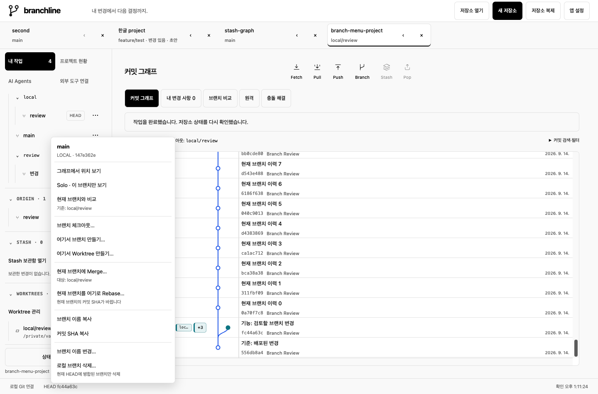
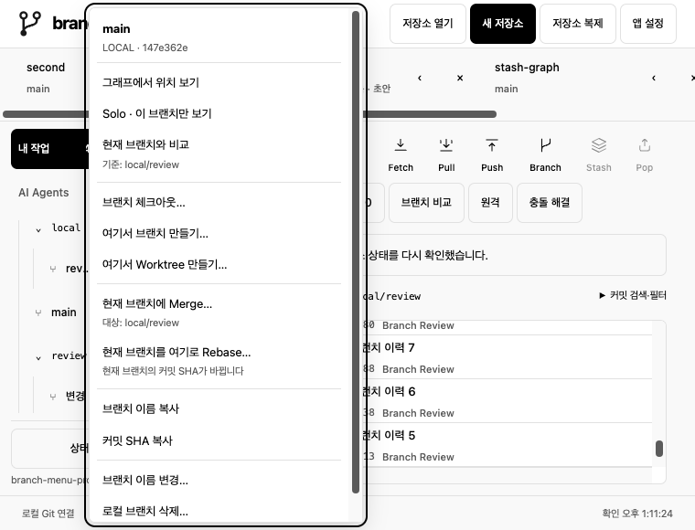

# 브랜치 우클릭 작업 — 2026-09-14

사용자가 제공한 GitKraken 메뉴를 참고해 Branchline의 실제 Git 기능과 공통 디자인 컴포넌트에 연결했다. 아래 이미지는 임시 저장소로 실행한 Branchline 화면이다.

## 개발자·PM 작업 구성

| 목적 | 구현한 동작 | 의미와 보호 |
| --- | --- | --- |
| 위치 파악 | 일반 클릭 / 그래프에서 위치 보기 | 전체 브랜치 그래프에서 해당 tip으로 이동하고 커밋 상세 표시. 필요한 이력을 자동 추가 조회. 체크아웃하지 않음 |
| 집중 조회 | Solo / Solo 해제 | 선택 ref에서 도달 가능한 이력만 조회. 공통 조상과 merge 부모도 포함하며 '그 브랜치에서 작성된 커밋만'을 뜻하지 않음 |
| 변경 검토 | 현재 브랜치와 비교 | A=선택 ref, B=현재 브랜치. 도입한 변경과 A에만 있는 커밋으로 기존 비교 화면 진입 |
| 작업 전환 | 로컬 체크아웃 / 원격 추적 체크아웃 | 원격은 새 로컬 브랜치 이름 확인 후 upstream 설정. 기존 이름 덮어쓰기 및 미보관 변경이 있는 전환 차단 |
| 병렬 개발 | 여기서 브랜치 / Worktree 만들기 | 선택 tip SHA로 기존 생성 Dialog 재사용. 새 브랜치·기존 로컬·detached Worktree 방식 유지 |
| 통합 | 현재 브랜치에 Merge / 현재 브랜치를 여기로 Rebase | 방향·SHA·이력 변경 영향을 검토 후 실행. 기존 충돌 해결·계속·중단 흐름 연결 |
| 협업 전달 | 브랜치 이름 / 커밋 SHA 복사 | 허용 저장소의 실제 ref/commit 검증 후 native clipboard 사용 |
| 정리 | 로컬 이름 변경 / 삭제 | 이름 덮어쓰기 없음. 현재/다른 Worktree 사용·미병합 브랜치 삭제 차단. 검토 이후 상태 변경 시 재검토 |

사이드바 각 브랜치에는 우클릭과 같은 `⋯` 메뉴를 제공한다. Shift+F10, 방향키, Enter, Escape를 지원한다. 그래프에서 표시 중인 브랜치 라벨도 같은 메뉴를 사용한다. `+N`으로 접힌 다른 ref는 사이드바에서 정확한 브랜치를 선택한다. 메뉴의 비활성 이유와 작업 대상은 텍스트로 제공한다.

## 이번 메뉴에 넣지 않은 항목

- PR/MR 직접 생성·링크: 기존 호스팅 화면에서 제공한다. 로컬 remote와 연결 계정·프로젝트, fork의 source/target 매핑을 확인하는 흐름을 마련한 뒤 메뉴에 연결한다. 임의로 프로젝트나 PR 번호를 추정하지 않는다.
- 원격 삭제, Reset/Drop/커밋 재배치, 강제 삭제: 공유 이력 변경·원격 권한·복구 검토가 필요한 별도 작업이다. 현재 메뉴에는 실행되지 않는 항목을 노출하지 않는다.
- AI 브랜치 설명, Hide/Pin, 태그 생성: 이번 구현 범위에 포함하지 않는다. 현재 AI는 기존 충돌 해결 흐름에서 사용한다.

## 검증

- `scripts/check-branch-menu.mjs`: 임시 저장소에서 100개 이후 위치 이동, 명시적 Solo, 키보드/우클릭/가시적 버튼, 라벨 메뉴, 복사, 비교 방향, 생성·이름 변경·병합 여부에 따른 삭제·추적 체크아웃, Dialog 재사용, 최소 창 경계.
- `electron/git.test.cjs`: 실제 Git으로 upstream 설정, 미병합/사용 중 Worktree 보호, 잘못된 이름·중복 이름·오래된 검토 토큰·SHA·미보관 변경 거부.
- 전체 결과는 [check.log](./check.log), 정적 UI 감사는 [premium-audit.json](./premium-audit.json).
- 실제 사용자 저장소·클립보드·계정에 쓰지 않았다. 실행 중인 사용자 앱을 재시작하거나 배포하지 않았다.

구현 참고: [Base UI Context Menu](https://base-ui.com/react/components/context-menu), [Git switch](https://git-scm.com/docs/git-switch), [Git branch](https://git-scm.com/docs/git-branch).

회귀 검사 중 동일 token/페이지의 상태 재조회로 상단 도구가 잠시 비활성화되는 구간도 수정했다. 같은 Git 상태의 유효한 snapshot은 새 조회 중 유지하고 실제 token이 바뀌면 새 결과를 기다린다. 변경 실행 전 검토 token 검증은 유지한다.

최종 `pnpm check` 통과: Storybook 104개, Git/Agent/호스팅 등 Node 테스트 30개, native UI·Electron E2E·오류 복구·재시작 검사 및 renderer/Storybook 빌드. 정적 UI 감사와 DESIGN.md lint는 오류·경고 0개다. detached HEAD의 비교 기준 표시도 임시 저장소에서 확인했다. 번들 크기 안내는 남아 있으며 서명·설치본·공개 릴리스 검증은 이번 범위가 아니다.
