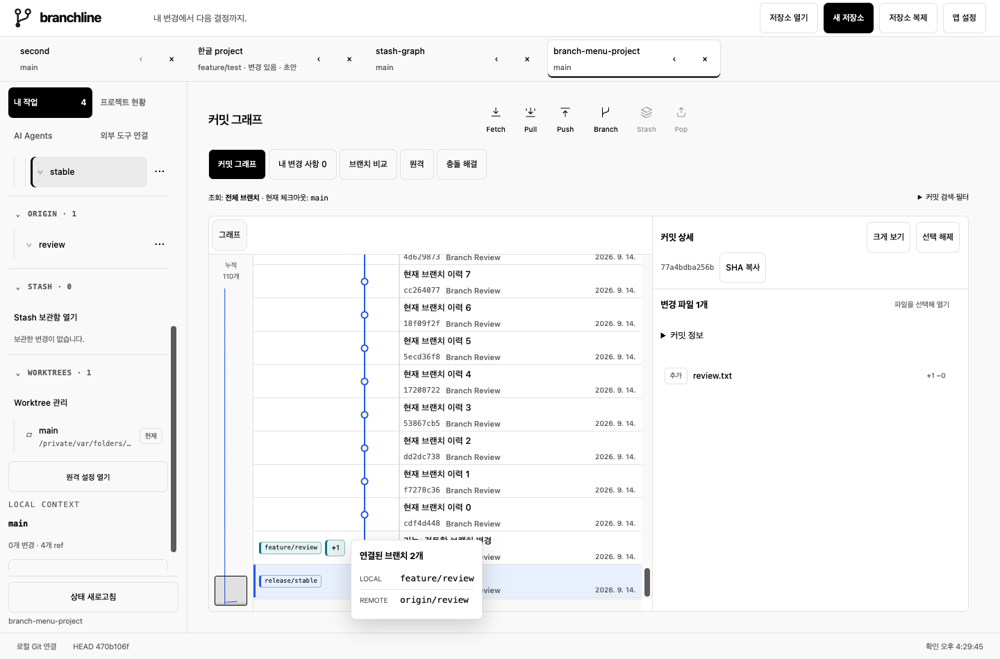

# 그래프 브랜치 목록 툴팁 · 2026-09-14

`+N`에 마우스를 올리면 같은 커밋을 가리키는 전체 참조 목록을 표시한다. 실제 브랜치는 LOCAL/REMOTE와 전체 이름으로 구분한다. 첫 번째로 표시된 브랜치도 목록에 포함하며 HEAD 상태는 별도로 유지한다.

공통 Tooltip과 기존 Badge를 재사용하고 그래프 행 안에 중첩 버튼을 만들지 않았다. 키보드 포커스는 기존 행과 공유한다. 첫 Esc는 툴팁만 닫으며 선택한 커밋과 체크아웃 상태를 바꾸지 않는다. 목록으로 마우스를 옮겨도 유지하고, 긴 이름은 줄바꿈·긴 목록은 내부 스크롤한다. 포털과 화면 경계 보정으로 그래프의 overflow에 잘리지 않게 했다. 별도 브랜치 컬럼과 좁은 화면의 인라인 배지 모두 같은 컴포넌트를 사용한다.

## 검증

`pnpm check` 전체 통과: Storybook 125개/38파일, Node 36개, native·실제 Electron·초안 복구·접근성·Storybook build. Premium strict와 DESIGN lint 오류·경고 0개. 기존 500kB 초과 번들 경고는 남아 있다.

- Storybook: 호버, 팝업 위 호버 유지, 키보드 포커스, Esc 닫기와 포커스 유지, 긴 이름, 기존 긴 브랜치 배지의 비중첩 레이아웃.
- 실제 Electron/임시 Git: +1의 실제 로컬/원격 목록, 팝업 경계, 호버·Esc·행 키보드 포커스가 선택 커밋과 체크아웃을 변경하지 않는지 확인한다.
- 실제 사용자 저장소나 계정은 테스트에 사용하지 않았다. 실행 중 앱 재시작·설치 번들 생성은 진행하지 않았다.

[전체 검사 로그](./check.log), [정적 UI 검사](./premium-audit.json), [디자인 문서 검사](./design-lint.json).

