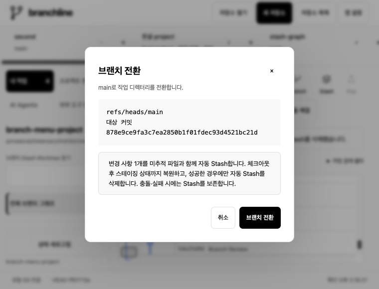
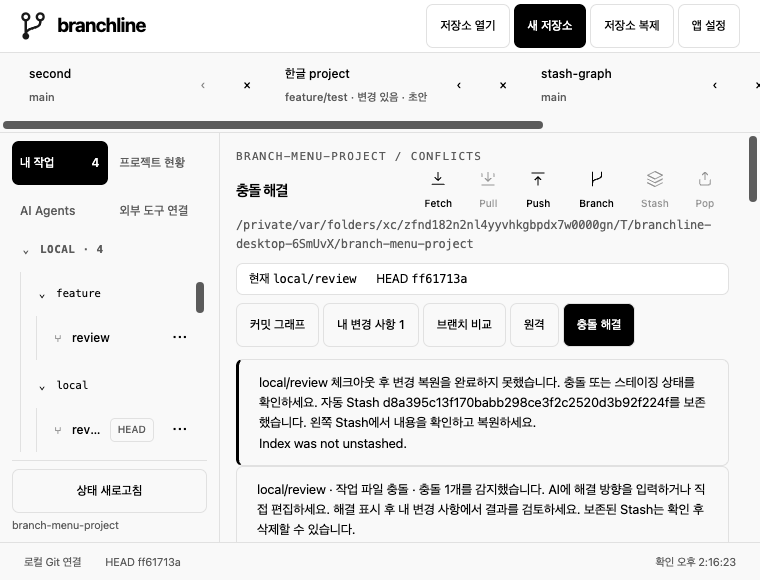

# 자동 Stash 체크아웃 · 2026-09-14

사이드바·그래프 우클릭, Solo에서 전환, 비교 화면의 체크아웃을 같은 흐름으로 연결했다. 기존 Dialog/Notice/Button을 재사용하며 확인 한 번으로 미추적 파일을 포함한 자동 Stash → 로컬/원격 추적 체크아웃 → 스테이징 상태를 포함한 apply → 성공 확인 후 자동 Stash 삭제를 수행한다.

실패 시 원본을 보존한다. 체크아웃 자체가 실패하고 원래 브랜치가 유지되면 깨끗한 작업 트리에만 복원을 시도한다. 적용 충돌이나 오류가 있으면 Stash를 남기고 실제 상태를 갱신한다. 충돌은 기존 수동/AI 해결 화면으로 연결하고, 해결 후 사용자가 결과를 확인하여 보관본을 삭제한다. 기존 Stash·무시된 파일은 보호하며 진행 중 Git 작업과 미해결 충돌은 자동 전환하지 않는다.

## 검증

`pnpm check` 전체 통과: Storybook 117개/35파일, Node 35개, native·실제 Electron·초안 복구·접근성·Storybook build. Premium strict 오류·경고 0개. 기존 번들 500kB 초과 경고는 남아 있다.

- 실제 임시 Git: 혼합 스테이징/미스테이징 변경, 한글 rename, 미추적 바이너리, 기존 Stash 유지, 오래된 검토 거부, 원격 추적 체크아웃.
- 실패 경로: apply 충돌과 보관 SHA의 원본 내용, 무시된 파일과 대상 추적 파일 충돌 시 전환 실패·원래 인덱스 복원·보관본 유지.
- Electron: 변경이 있어도 메뉴 활성화, 취소 시 저장소 불변, 자동 복원·삭제와 완료 안내, 적용 충돌의 자동 해결 화면 진입, 760×580 확인창과 접근성.
- 실제 사용자 저장소·로그인 세션은 검증에 사용하지 않았다. 실행 중 앱 재시작이나 설치 번들 생성은 이번 요청에 포함하지 않았다.

[전체 검사 로그](./check.log), [정적 UI 검사](./premium-audit.json).

## 범위

Merge/Rebase/Pull의 자동 Stash는 이번 변경에 포함하지 않는다. 서브모듈 내부 변경처럼 Git Stash가 보관하지 못하는 잔여 변경은 전환을 중단한다. 다른 터미널의 동시 쓰기는 앱 쓰기 큐에 참여하지 않는다. 삭제 직전 자동 Stash SHA를 대조하지만 외부 Git 프로세스까지 포함한 원자적 트랜잭션은 제공하지 않는다.
