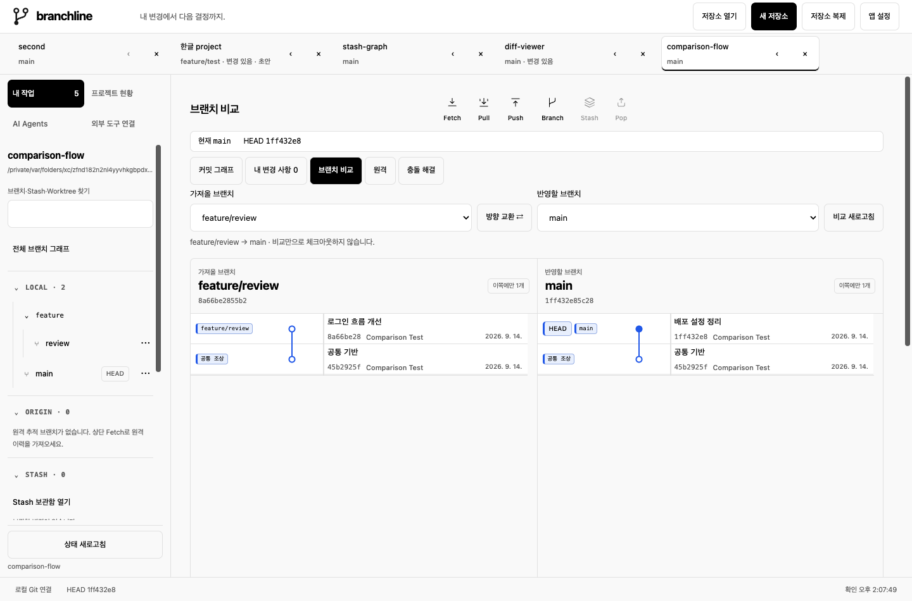
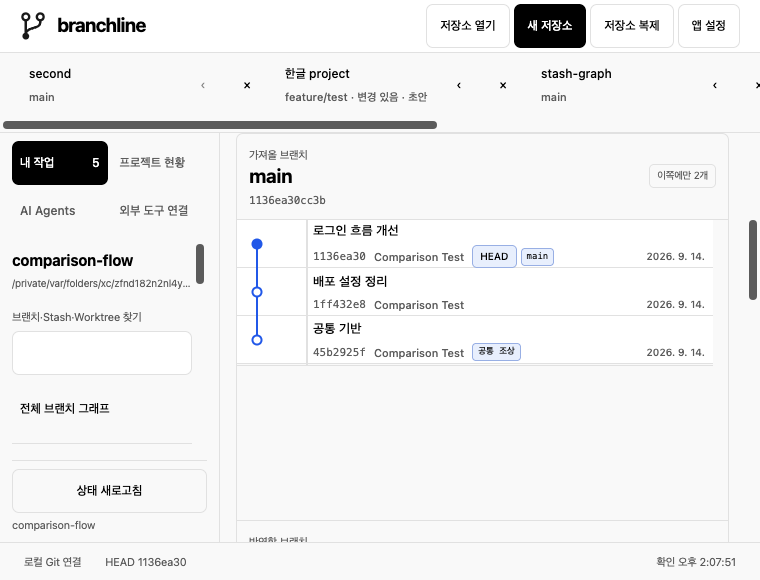

# 브랜치 비교 작업 개선 · 2026-09-14

## 구현한 흐름

1. `가져올 브랜치 → 반영할 브랜치`를 선택한다. 두 브랜치의 SHA·서로 다른 커밋 수와 그래프를 함께 표시하고 방향 교환은 조회만 바꾼다.
2. 공통 조상 버튼은 양쪽 그래프의 같은 SHA로 이동한다. 그래프는 각각 해당 브랜치에서 도달 가능한 이력을 100개씩 이어서 조회한다. 공통 커밋은 양쪽에 보이며 임의의 연결선을 만들지 않는다.
3. 커밋 선택 → 공통 상세 뷰어에서 변경 확인 → 현재 로컬 브랜치에 Cherry-pick 검토 → 실행. Merge 커밋은 부모 번호를 명시적으로 선택한다. 변경 사항·진행 중 작업·검토 이후 상태 변경은 실행 전에 차단한다. 충돌은 기존 수동/AI 해결과 계속·중단으로 연결하고 빈 Cherry-pick도 건너뛰기로 복구한다.
4. Merge는 반영할 브랜치가 실제 로컬 체크아웃일 때 활성화한다. Rebase는 현재 체크아웃과 기준을 버튼·확인창에 표시한다.
5. `PR/MR 만들기` → 작성 계정 선택 → 원격 프로젝트 명시적 확인 → 브랜치명 자동 입력 → 제목·본문 작성 → 최신 원격 SHA 확인 → 기존 최종 실행 검토. 비교 SHA가 서버 SHA와 다르면 Push/Fetch 후 다시 비교하도록 안내한다. 자동 Push나 fork 간 생성은 하지 않는다.

파일 차이와 범위별 커밋 목록은 별도 Disclosure로 제공한다. 모호한 A/B 표기는 실제 UI에서 제거했으며 기존 저장된 탭의 내부 a/b 값은 호환한다. 공통 조상이 없거나 여러 개이면 도입 변경 diff에만 안내를 표시하고 그래프와 현재 파일 차이는 유지한다. 좁은 창에서는 두 그래프를 위아래로 배치한다.

## 공통 컴포넌트

BranchComparison은 두 그래프의 제목·수치·공통 조상 표시를 소유한다. CommitGraph/HistoryGraph, InspectorPanel/CodeDiff, SelectField, Button, Badge, Notice, Pagination, Dialog를 재사용한다. PR/MR은 기존 HostActions와 Electron hosting-writes를 확장했다.

## 검증 근거

`pnpm check` 전체 통과: Storybook 117개/35파일, Node 31개, native·실제 Electron·초안 복구·접근성·Storybook build. Premium strict와 DESIGN lint 오류·경고는 0개다. Storybook 번들의 기존 500kB 초과 경고는 남아 있다. 설치 번들과 공개 release는 이번에 만들지 않았다.

- 실제 Git 임시 저장소에서 양쪽 이력의 분리와 공통 SHA 선택, 조회 중 checkout 보존, 방향 교환, Cherry-pick 취소·적용, 반영 브랜치 체크아웃 조건, 760×580 레이아웃과 접근성을 확인한다.
- Node 테스트는 stale token·dirty tree·단일 적용·빈 결과 skip·충돌 abort/continue·merge mainline 선택 및 원격 생성 SHA 불일치 거부를 확인한다.
- Storybook은 두 그래프·공통 조상 없음·좁은 상태와 PR/MR 계정·프로젝트 선택, 자동 브랜치명, 비교 SHA 전달, 최종 생성 및 계정/조회 오류를 확인한다.
- 실제 계정 게시나 사용자 저장소 변경 없이 임시 저장소와 통제된 제공자만 사용한다. 실행 중 사용자 앱은 재시작하지 않는다.

검증 로그: [check.log](./check.log), [정적 UI 검사](./premium-audit.json), [디자인 문서 검사](./design-lint.json).

재현: `pnpm build` 후 `BRANCHLINE_SCREENSHOTS=docs/comparison-2026-09-14 node scripts/check-comparison-standalone.mjs`.

단일 커밋 Cherry-pick과 같은 원격 프로젝트의 PR/MR 생성 범위다. 다중 커밋 큐·자동 mainline 추정·fork 매핑은 제공하지 않는다. [Git cherry-pick 공식 문서](https://git-scm.com/docs/git-cherry-pick)를 따른다.
