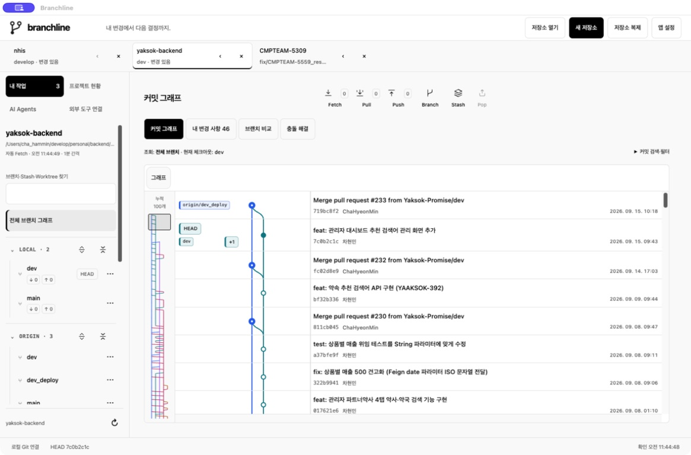
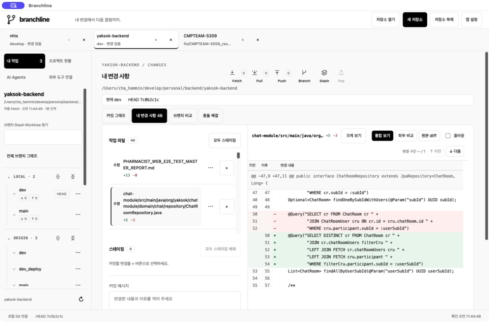
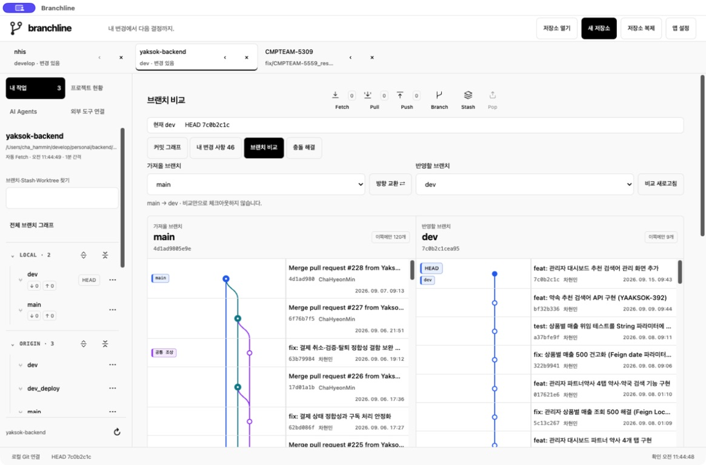
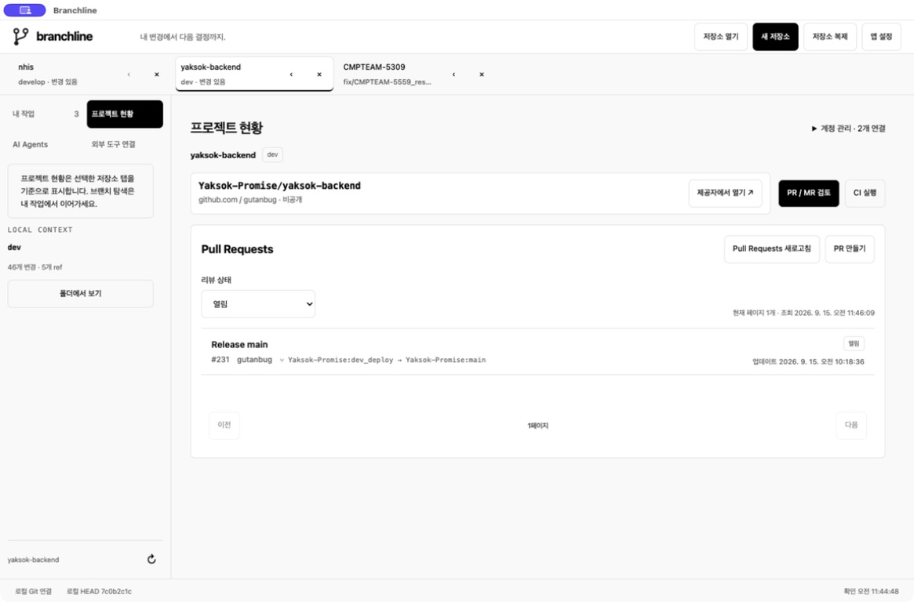
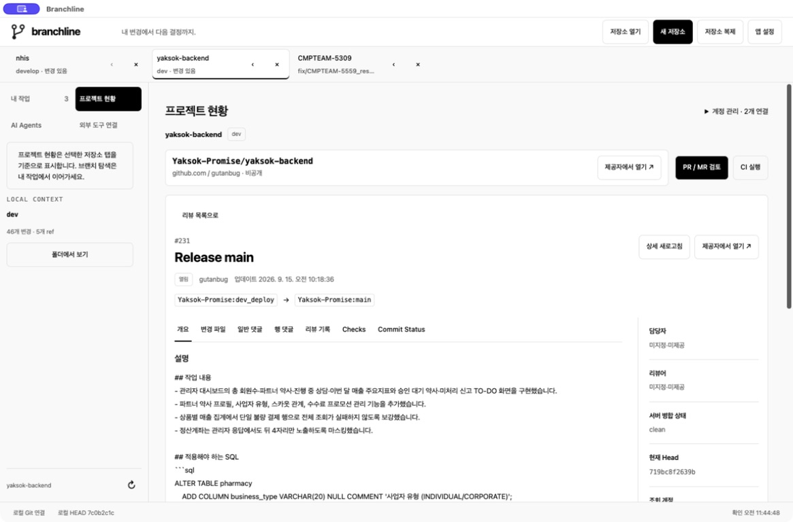
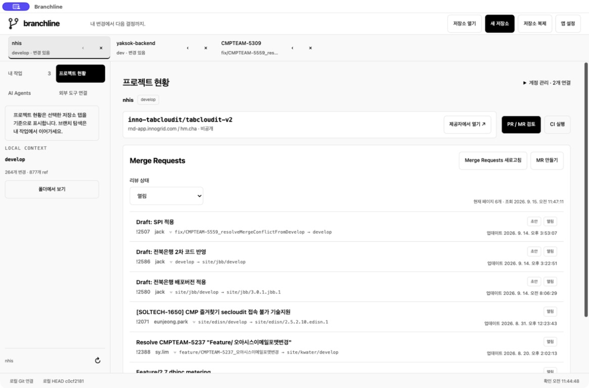
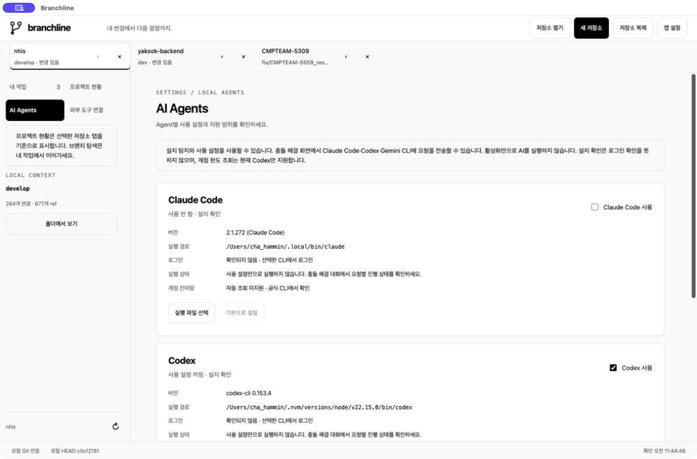
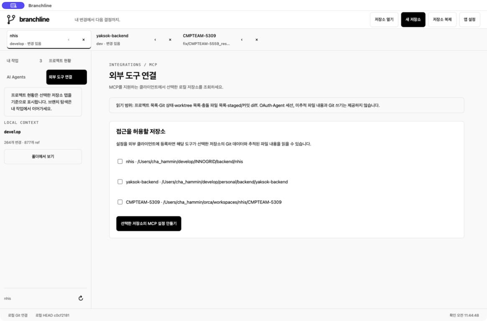
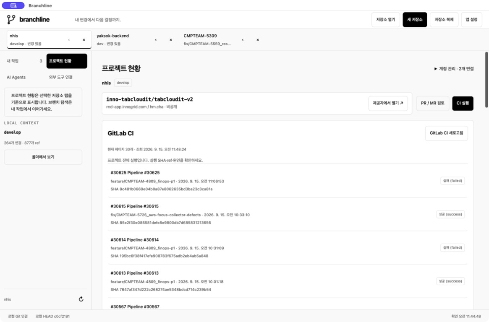
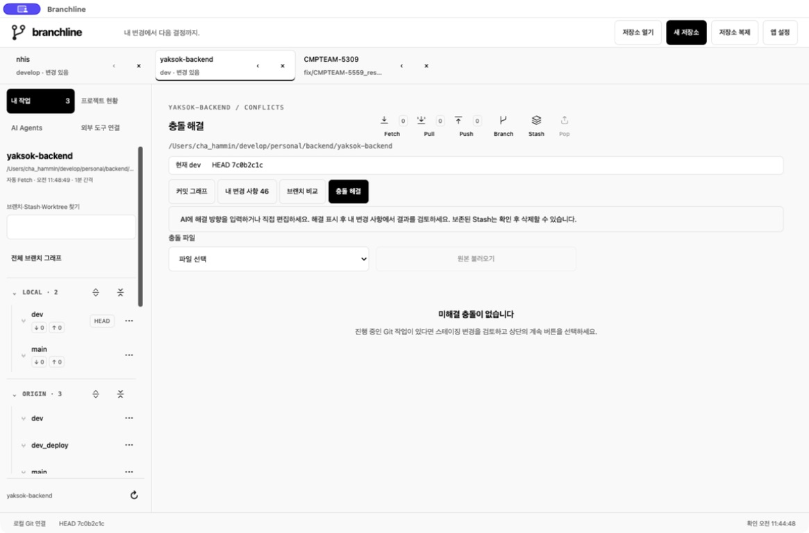

# Branchline 기능 완성도 평가 · 2026-09-15

현재 판단: **실사용 가능한 개인 Git 도구의 로컬 알파. 팀의 표준 도구 또는 상용 배포 완성 단계로 판단할 근거는 부족하다.** 개발자와 PM의 우선순위는 동등하지만, 구현된 작업 깊이는 개발자 쪽이 더 높다. 기능 수나 임의의 백분율 대신 실제 연결, 작업 완결성, 복구, 검증 범위를 구분했다.

## 검토 방법과 한계

이번 실행에서 macOS Electron 앱의 실제 열린 저장소를 읽기 전용으로 탐색했다. 그래프 → 내 변경 사항 → 브랜치 비교 → GitHub PR 목록/상세 → 회사 GitLab MR 목록 → Agent → MCP → GitLab CI → 충돌 없음 상태를 새로 캡처했다. 아래 이미지는 이번 검토에서 직접 본 실행 화면이다. 사용자 저장소에서 stage, commit, checkout, Pull, Stash, PR/MR 게시/승인/병합, 유료 AI 실행은 하지 않았다. 기존에 설정된 앱 자동 Fetch는 그대로 동작한다.

최신 소스의 빌드는 성공했다. Node/Git 회귀 검사는 임시 저장소와 통제된 API/CLI 입력으로 별도 실행했다. 기존 UI 전체 검사 통과 기록을 이번 감사의 실계정 쓰기 검증으로 간주하지 않는다. Windows/Linux, 서명 설치본, 수만 건 성능, 실제 AI 추론 품질, 스크린리더 전체 흐름은 이번 검토에서 검증하지 않았다. 평가는 기능 구현 여부와 현재 관찰 가능한 사용성에 대한 것이며 보안 인증이나 전체 무결함 판정이 아니다.

## 기능별 판단

| 영역 | 현재 수준 | 확인한 근거 | 미완료 또는 확인이 필요한 부분 |
|---|---|---|---|
| 개인 Git 기본 작업 | 핵심 흐름 구현 | 실제 상태/파일별 diff, 작업·스테이징 분리, 변경 줄 수, 공통 메뉴. Git 테스트로 변경 동작 검증 | 부분(hunk/행) stage, 전용 Revert/Reflog 복구, 숙련자 작업 속도 |
| 브랜치·Stash·Worktree | 폭넓게 구현 | 그래프와 ref, 사이드바, 비교, 생성·전환·Stash·Worktree 코드/회귀 경로 | tag/submodule·원격 정리 등 고급 관리. 이번 실사용 화면에서 쓰기 실행은 하지 않음 |
| Checkout/Pull 복구 | 방어 로직 구현 | 자동 Stash와 staged/working 복원, 실패 시 원본 보존 테스트 경로 | 실제 조직의 hooks·서명·인증 환경 장기 검증. Pull은 fast-forward 범위 |
| 그래프·이력 탐색 | 중간 규모 사용 가능 | 현재 저장소 그래프 조회, 두 브랜치 비교 | SHA 통합 검색, 대량 렌더링/가상화, 필터와 상태 복원 정교화 |
| GitHub/GitLab | 실제 조회 확인 | 열린 탭에 맞는 GitHub PR 목록·상세, 회사 GitLab MR·CI 목록 조회 성공 | OAuth 재등록/만료/조직 정책/보안 저장 및 실제 원격 쓰기는 별도 검증 |
| PM 작업 | 자료 조회 중심 | 작성자·방향·상태·PR 본문·Head 검사 요약 | 담당/리뷰 요청/실패 CI/오래된 MR 필터, 다중 프로젝트 우선순위, 병합 차단 이유와 필수 정책 종합 |
| AI 충돌 보조 | 제한된 연결 구현 | 세 CLI 설치 탐지, 토글, Codex 사용량 UI, 단일 파일 수정안/Amend 요청 코드 | 앱 내 로그인 확인, Claude/Gemini quota, 실제 추론 검증, 스트리밍/진행 중 지시. 현재 화면의 설치 확인은 로그인 성공을 뜻하지 않음 |
| 외부 연동 | 읽기 MCP 초기 단계 | 저장소 허용 범위와 설정 생성 화면, 읽기 도구 구현 | 외부 클라이언트 연결 진단·실사용 검증, IDE 플러그인, 쓰기 계약 |
| 배포 | 개발용 실행/번들 | package-desktop.mjs는 unsigned bundle 생성 | 서명·공증·업데이트·OS별 설치/업데이트 복구 검증 |

## 우선순위

### 출시 전에 해결할 조건 — 확인된 결함과 구분

1. **배포 신뢰성:** 현재 packager에 서명/공증/업데이트 설정이 없다. 배포 대상 OS를 확정하고 설치 → 최초 실행 → 업데이트 → 실패 복구를 검증해야 한다. 기능을 더 추가하는 것으로 대체할 수 없는 출시 조건이다.
2. **실제 환경의 쓰기·인증 검증:** 이번에 실제 GitHub/GitLab 읽기는 확인했다. PR/MR 생성·승인·병합, 보호 브랜치 거부, 만료된 PAT/토큰, hooks·서명, 자동 Stash 충돌 복원은 전용 검증 저장소에서 확인해야 한다. 현재 테스트 성공을 운영 환경 성공으로 확대하지 않는다.
3. **대형 저장소 기준 측정:** `CommitGraph.tsx`는 불러온 모든 커밋을 map으로 렌더링하고 `HistoryGraph.tsx`는 누적 보관한다. `DesktopApp.tsx`는 활성 저장소 상태를 5초마다 조회한다. 수만 커밋·수백 ref에서 느리다고 단정하지 않지만, 시간/메모리 측정 없이 대형 저장소 대응 완료로 볼 수 없다.

### 관찰된 UX 마찰·기능 공백 — P2

| 순서 | 문제와 사용자 영향 | 근거 | 권장 변경 | 상태 |
|---|---|---|---|---|
| 1 | 변경 파일이 많을 때 찾기 어렵다. 46개 중 현재 캡처의 작업 파일 영역에는 약 두 행만 보이고 긴 경로가 여러 줄을 차지한다 | 02, RepositoryWorkspace 파일 목록 | 파일명 중심 1행 + 경로 보조, 검색/Tree, 목록 높이 조절. 이후 hunk/행 stage | 1차 구현: 검색·트리·높이·텍스트 hunk 완료, 행 선택은 후속 |
| 2 | PM은 목록에서 다음 할 일을 정하기 어렵다. 리뷰 상태 외 담당자·리뷰 요청·CI 실패·경과시간 필터가 없다 | 04/06/09, HostingWorkspace.ProjectFeed | ‘내 검토 요청’, ‘검사 실패’, ‘오래 대기’ 필터와 MR별 실제 CI 요약 | 2차 구현: 서버 제목·내 역할·업데이트 경과 필터, 3차 현재 페이지 Head CI 실패 필터·미확인 안내 구현(전체 집계 제외) |
| 3 | 리뷰 본문의 `##`, 코드 fence가 원문으로 표시되어 설명·SQL·링크를 훑기 어렵다. 서버 상태 `clean`도 원문이다 | 05, HostingWorkspace.Detail/queries.status | 안전한 Markdown 렌더링과 상태 번역. 원문 보기 유지. 서버 병합 가능 상태를 정책 통과로 번역하지 않음 | 2차 구현: Markdown/원문·서버 병합 상태 번역 |
| 4 | 그래프와 비교 화면에서 상단 문맥·탭이 높이를 차지하고 실행 작업은 아래에 놓인다. 양쪽 그래프에서는 긴 커밋 제목이 쉽게 잘린다 | 01/03 | 중복 헤더 압축, 비교 방향/주요 액션을 같은 툴바에 유지, 패널 비율 조정 | 미수정 |
| 5 | Agent 화면은 ‘설치됨·로그인 미확인·사용 켜짐’을 긴 설명으로 구분한다. 실제 요청 가능 여부를 한눈에 판단하기 어렵다 | 07, AgentSettings | 설치/로그인/한도/실행 가능 상태를 분리한 간결한 상태 표와 진단. 미지원 quota는 그대로 명시 | 미수정 |
| 6 | 충돌이 없는데도 ‘AI에 입력’ 안내와 빈 파일 선택, 비활성 불러오기 버튼을 먼저 보여준다 | 10 | 충돌 없음 상태를 우선 표시하고 관련 입력은 필요할 때 노출. 작업이 없을 때 가상의 ‘상단 계속 버튼’ 안내 생략 | 미수정 |
| 7 | AI/MCP 화면에서도 사이드바가 ‘프로젝트 현황은…’이라고 설명한다 | 07/08 | 상위 화면에 맞는 도움말 또는 중복 안내 제거 | 미수정 |
| 8 | 구현 상태 문서 상단 표와 후속 항목이 충돌한다. 예: 이름 변경/삭제·Self-Managed·split view가 상단에는 남은 범위지만 후속 구현과 코드에 존재한다 | IMPLEMENTATION.md 상단/후속 항목, 실제 화면 | 상단 현재 상태 표를 최신 단일 기준으로 갱신하고 과거 기록을 이력으로 분리 | 미수정 |

P0 데이터 손실/권한 침해 또는 P1 핵심 작업 실패를 이번 읽기 전용 탐색에서 재현한 것은 없다. 이것이 해당 결함의 부재를 보장하지는 않는다. 부분 staging·태그·Reflog 등 미구현 기능은 기존 기능의 버그와 구분한다.

## 단계별 화면과 평가

1. **커밋 그래프 — 핵심 탐색 양호, 화면 밀도 보완.** 실제 ref·시간·분기와 중앙 작업/탭을 확인했다. 상단 문맥이 차지하는 높이와 긴 제목 처리에는 개선 여지가 있다.

2. **내 변경 사항 — diff 양호, 파일 탐색 마찰.** 통합 diff의 추가/삭제 구분과 줄 수는 명확하다. 파일명 중복/하단 반복 문구는 제거된 상태다. 작업 목록은 46개 대비 화면당 노출이 적다.

3. **브랜치 비교 — 방향 명확, 작업 접근성 보완.** 가져올 브랜치/반영할 브랜치와 공통 조상은 이해하기 쉽다. 현재 변경 사항 때문에 Merge/Rebase가 비활성인 것은 보호 동작이며 결함으로 보지 않는다. 액션을 찾으려면 화면 아래로 이동해야 한다.

4. **GitHub PR 목록 — 실제 연결 양호, 필터 부족.** 열린 저장소와 같은 원격 프로젝트로 자동 연결됐다. 목록 하나를 조회했으며 다른 계정의 목록과 섞이지 않았다.

5. **PR 상세 — 자료 조회 양호, 표현/최종 판단 제한.** 실제 제목·작성자·브랜치·본문·Head 검사 정보가 표시됐다. Markdown은 원문이며 검사 요약은 첫 페이지와 제공자 정책 확인 한계를 명시한다. 읽기 성공은 병합 쓰기 성공의 증거가 아니다.

6. **회사 GitLab MR — 실제 연결 확인.** 탭을 회사 저장소로 바꾸자 해당 프로젝트 MR 6개가 표시됐다. 현재 로그인/PAT 입력 방식 자체를 새로 실행하거나 자격 증명을 열람하지 않았다.

7. **AI Agents — 설정 구현, 요청 성공 미검증.** 세 CLI 설치/버전과 사용 설정을 확인했다. 화면만으로 실제 계정 로그인이나 추론 성공을 판정할 수 없다. 설정·사용량 새로고침·유료 요청은 실행하지 않았다.

8. **MCP — 범위 명확, 외부 연결 미검증.** 읽기 범위 및 저장소 선택은 명확하다. 클라이언트 설정 생성/등록과 도구 호출을 이번 실행에서는 하지 않았다.

9. **GitLab CI — 실제 목록 양호, 조치 중심 탐색 부족.** 파이프라인·ref·SHA·성공/실패를 확인했다. 실패만 보기나 브랜치 필터가 없고 전체 SHA/중복 번호가 공간을 차지한다. 재실행·취소를 수행하지 않았다.

10. **충돌 없음 — 안내 개선 필요.** 미해결 충돌이 없는 상태를 올바르게 표시하지만, 관련 없는 입력과 안내를 먼저 보여준다. 실제 충돌을 일부러 만들지는 않았다.

## 권장 다음 구현 순서

변경 파일 탐색/부분 staging → PR/MR 작업 필터/Markdown/정책 요약 → 대형 그래프 성능 측정과 최적화 → 실제 Agent 진단/추론 검증 → 배포 서명/업데이트 검증. 출시를 바로 추진한다면 배포·실환경 검증을 첫 단계로 당긴다. 공통 컴포넌트 재사용 원칙을 유지하고 한 화면씩 작업 완료 시간·오류 복구를 확인한다.

현재 장점은 한국어 Git 작업과 로컬 변경 보존, 브랜치/Worktree/PR 자료가 한 앱으로 연결된 점이다. 가장 큰 부족은 메뉴 개수가 아니라 **많은 변경과 리뷰 중 지금 처리할 것을 빠르게 고르고, 결과를 확신하는 과정**이다.

검증 결과: 이번 `pnpm test:git`은 48개 모두 통과했다(종료 코드 0, `git-check.log`). 실제 임시 Git 저장소와 통제된 Agent/API 응답의 검사이며 실계정 원격 쓰기·AI 추론 검증은 포함하지 않는다. 앱 소스는 수정하지 않았고 화면은 원래 개인 저장소의 커밋 그래프로 되돌렸다.

## 개선 진행 · 2026-09-15

1차 개선은 변경 파일 탐색과 일반 텍스트 hunk 스테이징/해제다. 위 평가는 변경 전 관찰 기록이며, 수정·검증 결과는 [1차 개선 기록](../change-navigation-2026-09-15/README.md)에 구분한다. 다음 단계는 PR/MR 작업 필터와 본문 가독성이다. 나머지 항목을 완료로 간주하지 않는다.

2차 개선: [PR/MR 필터·본문 구현 및 검증](../review-workflow-2026-09-15/README.md).
