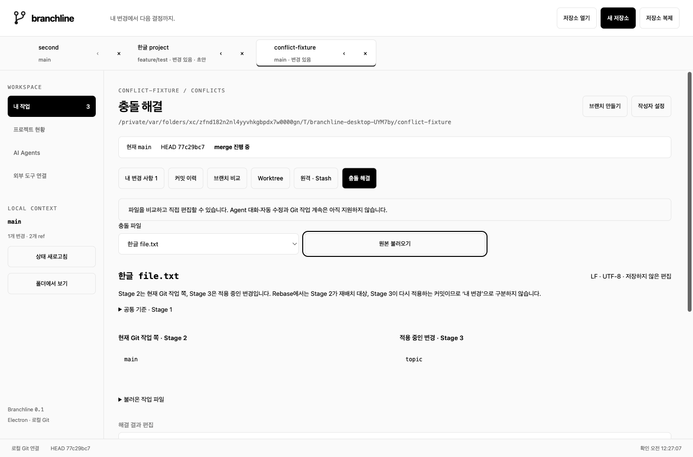
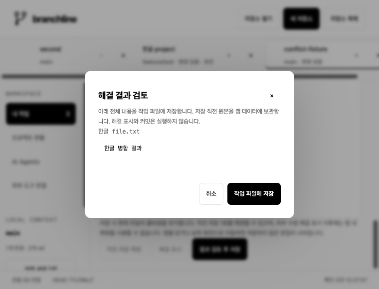

# 수동 충돌 해결 구현·검증

2026-09-14 · 로컬 알파 0.1.0

## 구현 결과

기존에는 충돌 중 커밋을 차단하고 외부 편집기로 안내했다. 이제 `내 작업 → 충돌 해결`에서 실제 Git Stage 1/2/3과 작업 파일을 비교하고 직접 편집한다. 전체 결과 검토, 원본 재검사 후 저장, 직전 저장 복원, 선택 파일 해결 표시를 각각 제공한다. 디자인 시스템의 기존 컴포넌트만 조합했다.

| 우선순위 | 처리한 문제 | 검증 |
| --- | --- | --- |
| P1 | 앱에서 충돌 내용을 편집·해결 표시할 수 없음 | 실제 merge fixture에서 저장 후 unmerged 유지, 해결 표시 후에만 선택 파일 스테이징 |
| P1 | 오래된 원본으로 외부 편집을 덮어쓸 위험 | 파일 바이트·mode·인덱스·Git 작업 식별 정보 변경 시 쓰기 거부, 초안 유지 |
| P1 | 복원·rebase·특수 파일 처리의 잘못된 결과 위험 | 원본 복원, rebase stage 구분, linked worktree 분리, 누락 stage, 바이너리·링크·크기·인코딩 차단, CRLF/실행 모드 보존 |
| P2 | 확인 없이 편집 폐기·한글 입력 중 실행·좁은 화면 조작 문제 | 재조회 폐기 확인/Escape, IME Enter로 실행 없음, 로컬 보기 전환 초안 유지, 760×580 검토 모달과 axe 검사 |

## 실제 검증

- [전체 검사 로그](./check.log): lint·renderer build, Storybook 63개, native, Node 21개, 실제 Electron Git/호스팅/충돌/품질 회귀, Storybook build 통과.
- [최종 충돌 테스트](./conflict-tests.log): CR 단독 줄바꿈 저장 차단까지 반영한 Node 5개 통과.
- [번들 생성](./package.log), [번들 실행](./packaged-verification.log): 최신 소스를 포함한 서명 없는 macOS arm64 Electron 실행 검증 통과.
- premium strict audit 오류/경고 0, DESIGN lint 오류/경고 0. 기존 컴포넌트를 조합했으므로 새 공통 UI와 의존성을 추가하지 않았다.
- 사용자 저장소 변경·실제 로그인·유료 AI 추론·외부 PR/CI 쓰기·서명·공개 release는 수행하지 않았다. 모든 Git 쓰기는 임시 저장소에서 검사했다. OAuth/API는 통제된 응답이다.

## 남은 범위

AI 대화·자동 수정·취소, merge/rebase 계속·중단, 삭제 선택·바이너리/특수 파일 해결, 충돌 초안의 탭 닫기/상위 화면 이동/재시작 복원, 백업 관리 UI가 남아 있다. 직전 파일 사본은 앱 데이터에 평문·제한된 파일 권한으로 보관하며 같은 충돌과 적용 결과에서만 앱 내 복원을 제공한다. 외부 Git 프로그램과 최종 교체/add 사이의 트랜잭션을 보장하지 않는다. 기존 PR/MR·CI 쓰기와 서명 릴리스 백로그도 유지한다. 전체 제품의 무결함이나 AI 기능 완료를 의미하지 않는다.
