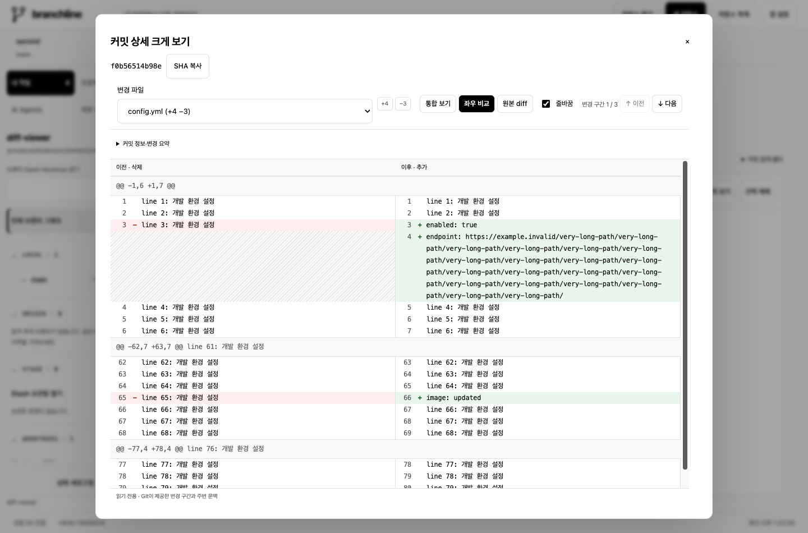
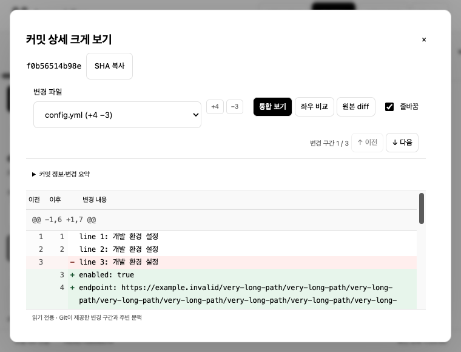

# Diff 검토 화면 · 2026-09-14

사용자가 제공한 통합·좌우 diff 예시를 참고해 기존 흑백 컨트롤과 공통 CodeDiff를 확장했다. 아래 화면은 임시 저장소의 실제 Git patch를 실행한 Electron 화면이다.

- 커밋·작업 파일·브랜치 비교·Stash·PR/MR이 같은 CodeDiff를 사용한다. 통합/좌우/원본, 파일 선택, 추가·삭제 수, 이전·이후 줄 번호, 변경 구간 이동, 줄바꿈을 제공한다.
- Git hunk의 시작 줄과 추가·삭제 개수로 줄 번호를 계산한다. 좌우 비교는 연속 변경을 순서대로 맞추고 빈 쪽은 사선으로 구분한다. 마지막 개행 없음 표시와 한국어 경로를 유지한다.
- Git이 제공한 변경 구간과 주변 문맥을 표시한다. 전체 파일·문법 하이라이팅·의미 단위 줄 매칭을 제공한다고 주장하지 않는다. 병합 combined diff·불완전한 patch는 안내와 원본으로, 바이너리·rename·mode 변경만 있는 파일은 메타데이터로 표시한다.
- 충돌 원본·AI 수정안·미추적 파일은 원문 모드로 분리한다. 코드의 `+`/`-`가 변경으로 해석되지 않는다.
- 브랜치 비교는 기존 SHA/방향을 유지하고 통계와 실제 patch를 함께 조회한다. 조회 중 checkout이나 작업 파일 변경은 없다.
- 작업 파일 상세의 개별 컨테이너를 InspectorPanel로 교체했다. 확대해도 선택 파일·보기 방식·스크롤 위치를 유지하며 좁은 창에서도 도구막대와 코드 스크롤을 분리한다.
- 앱/기능 화면의 개별 오류·로딩을 Notice로, 비교·Stash의 개별 페이지 이동을 Pagination으로 교체했다. Notice compact와 Pagination 범위/버튼 문구를 확장하고 Storybook에 추가했다. 실제 앱/기능 경로에서 별도 button/input/select/textarea/dialog, alert/status 및 pagination 구현이 남지 않았음을 검색으로 확인했다. 공통 컴포넌트 내부의 네이티브 요소와 페이지 배치 구조는 유지한다.

## 검증 결과

`pnpm check` 전체 통과: lint, renderer build, Storybook 111개/33파일, native UI, Node Git·연동 30개, Electron E2E·복구 검사, Storybook build. Premium strict 및 DESIGN lint 오류·경고 0개. 기존 번들 크기 경고는 남아 있으며 설치 패키징·서명·release는 이번 실행 범위가 아니다. 실행 중인 사용자 앱은 재시작하지 않았다.

## 검증 범위

- Storybook: 줄 번호, 새 파일의 0 시작 범위, 코드에 포함된 `---`/`+++`, 개행 없음, 불완전 patch, combined diff, 파일 전환, 비교 전환, 탐색, 원문·빈·좁은 상태.
- 실제 Electron 임시 저장소: Git patch와 줄 번호, 여러 파일 선택, 확대 상태 유지, 긴 코드의 가로 스크롤, 줄바꿈, 구간 이동, 760×580 창, 미추적 원문, axe 접근성, 조회 전후 Git 상태 보존.
- 기존 Stash/PR/MR 테스트는 부호와 코드가 분리된 DOM 및 파일 선택 흐름으로 갱신했다. 실제 사용자 저장소·계정은 테스트하지 않는다.

구현: `src/design-system/CodeDiff.tsx`, `diff-model.ts`, `InspectorPanel.tsx`. 재현: `BRANCHLINE_SCREENSHOTS=docs/diff-viewer-2026-09-14 node scripts/check-diff-standalone.mjs` (먼저 `pnpm build`). 전체 검증 결과는 [check.log](./check.log), 정적 UI 검사는 [premium-audit.json](./premium-audit.json)에 기록한다.

Git 형식 근거: [공식 diff-format](https://git-scm.com/docs/diff-format).
