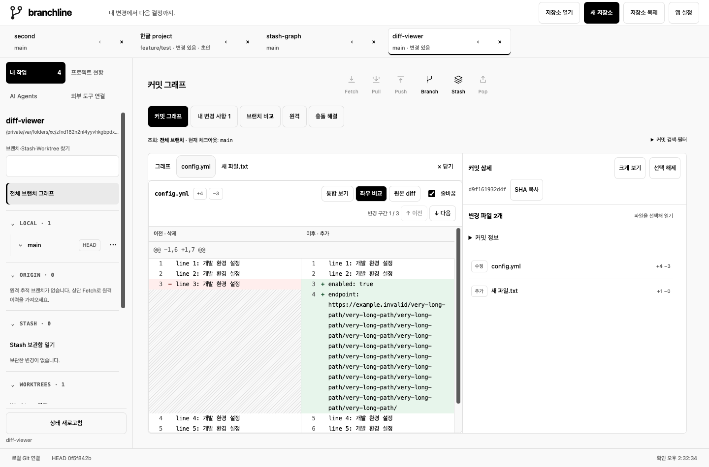
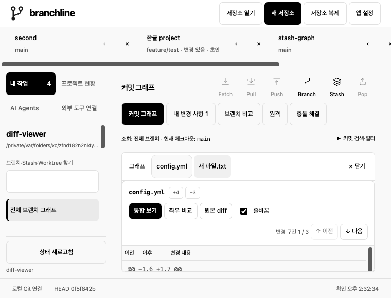

# 커밋 파일 목록과 diff 탭 · 2026-09-14

커밋/Stash를 선택하면 오른쪽에는 파일 경로·변경 상태·추가/삭제 행 수를 표시한다. 코드는 파일을 선택한 뒤 그래프 영역의 새 탭에서 연다. 같은 파일은 기존 탭을 활성화하고 다른 파일은 별도 탭으로 연다. 커밋 선택이 바뀌거나 사이드바에서 위치를 다시 요청하면 이전 파일 탭을 정리한다.

활성 파일의 `× 닫기`, Esc 또는 탭에서 Delete로 파일을 닫고 그래프로 복귀한다. 커밋 선택과 그래프 스크롤은 유지한다. 그래프와 열린 파일 뷰어를 숨긴 상태로 유지하여 재전환 시 로딩 범위·컬럼 너비·diff 보기 방식·스크롤이 초기화되지 않게 한다. 탭은 좌우/Home/End 키로 전환할 수 있다. IME 조합의 Esc와 모달의 Esc는 파일 닫기로 처리하지 않는다.

확대한 파일 목록에서 파일을 열면 확대를 닫고 diff 탭으로 이동한다. 작은 창에서는 파일 탭에 전체 너비를 배정하고 그래프 탭으로 돌아오면 오른쪽 파일 목록을 다시 표시한다. 변경 없는 커밋·추가·삭제·rename·바이너리·불완전 diff 상태를 구분한다.

공통 DiffFileList·ContentTabs를 공개하고 Storybook에 예제·키보드·빈 상태·좁은 화면을 추가했다. 기존 InspectorPanel·CodeDiff·Button·Badge·Disclosure를 재사용했다. 커밋 Merge 파일 목록은 [Git의 첫 번째 부모 비교](https://git-scm.com/docs/git-show)를 사용하며 화면에 기준을 표시한다. 실제 저장소를 쓰거나 체크아웃하지 않는 조회 변경이다.

## 검증 근거

`pnpm check` 전체 통과: Storybook 122개/37파일, Node 36개, native·실제 Electron·초안 복구·접근성·Storybook build. Premium strict와 DESIGN lint 오류·경고 0개. 기존 500kB 초과 번들 경고는 남아 있다.

- 실제 Electron: 목록에 코드가 없는 초기 상태, 파일 탭 위치, 중복 방지, 다중 파일 전환, 통합/좌우/원본 diff, 줄 번호와 변경 구간 이동, 줄바꿈과 가로 스크롤.
- 닫기 버튼·Esc·IME Escape·다른 커밋 선택·그래프 선택과 스크롤 복원, 확대 목록에서 파일 열기, 760×580 레이아웃·접근성.
- 실제 임시 Git의 Merge 커밋이 첫 부모 기준 파일을 반환하며 HEAD/작업 파일 상태는 유지되는지 검사한다.
- 실제 사용자 저장소·계정은 테스트에 사용하지 않았다. 실행 중 앱 재시작과 설치 번들 생성은 이번에 진행하지 않았다.

[전체 검사 로그](./check.log), [정적 UI 검사](./premium-audit.json), [디자인 문서 검사](./design-lint.json).

표시 내용은 Git의 변경 구간과 주변 문맥이다. 전체 파일 원문 조회와 편집은 추가하지 않았다. 브랜치 비교의 두 그래프 화면과 작업 파일 편집은 기존 검토 흐름을 유지한다.
