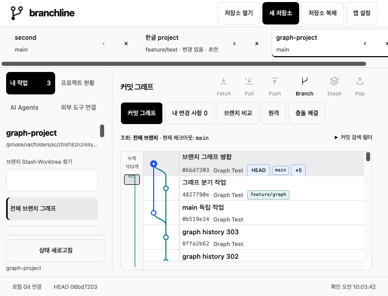
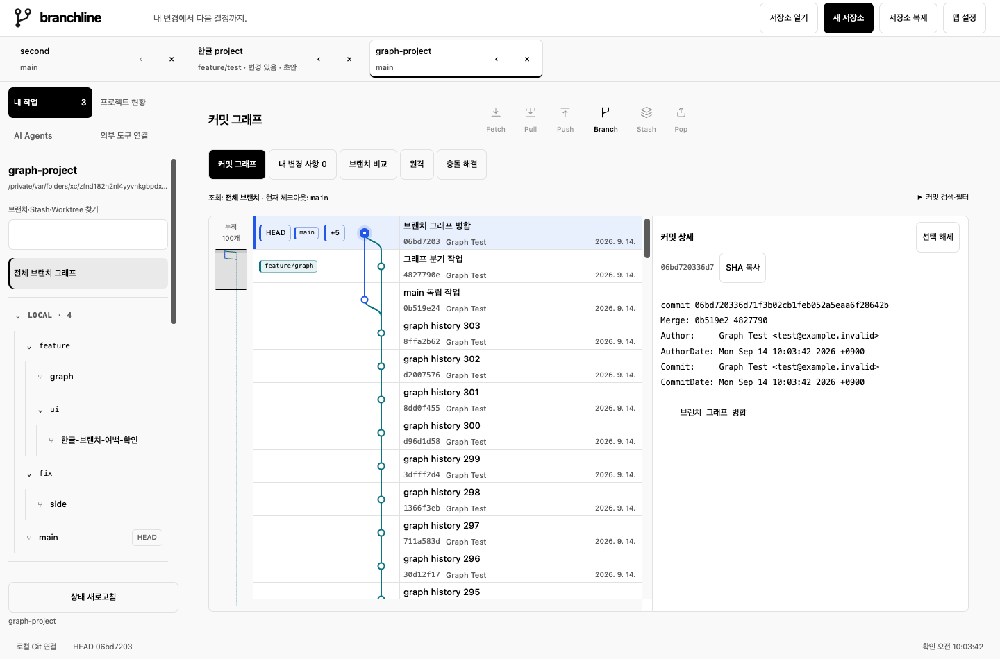

# 숙련 Git 사용자 기준 UX 검토

2026-09-14 · Branchline Electron · 실제 임시 Git 저장소와 실행 화면 기준.

핵심 문제는 기능의 개수보다 **현재 Git 상태와 화면의 일치, 커밋 탐색에 쓰는 면적, 반복 작업의 이동 비용**이었다. 그래프와 브랜치 조회를 checkout과 분리하는 방향은 유효하다. 다만 ref가 바뀌어도 목록이 갱신되지 않는 결함과 선택 전 상세 패널이 공간을 차지하는 문제는 일상 작업에 직접 영향을 주었다.

## 확인한 작업 흐름

| 단계 | 작업과 관찰 | 수정 후 상태 | 근거 |
| --- | --- | --- | --- |
| 1 | 저장소 열기 → 그래프 탐색. 선택하지 않았는데 상세 안내 칸과 하단 버튼이 계속 공간을 점유 | 선택 전 그래프 전체 너비. 설명·최신·더 불러오기 삭제. 스크롤로 자동 추가 | [수정 전](./01-before-history.png), [수정 후](./history-full-width.png) |
| 2 | 커밋 선택 → 같은 커밋 다시 클릭. 선택이 해제되지 않음 | 재선택·Esc·선택 해제로 닫기. 위아래 키로 인접 커밋 탐색, SHA 복사 추가 | [수정 전](./02-before-reselect.png), [수정 후](./repository-graph.png) |
| 3 | 외부 Git 커밋 → 앱의 상태 새로고침. footer HEAD만 갱신되고 새 커밋은 그래프에서 누락 | HEAD/ref 변화에 자동 재조회. 읽은 범위를 한 번에 교체하고 스크롤 중인 커밋 위치 유지 | [수정 전](./03-before-refresh.png), [실행 관찰](./audit-before.log), [수정 후](./history-auto-refresh.png) |
| 4 | 두 브랜치 비교 → 차이 커밋 검토. 선택 전 빈 상세와 그래프의 선택 계약이 다름 | 비교도 선택할 때만 공통 InspectorPanel 표시, 같은 행을 다시 누르면 해제 | [수정 전](./04-before-compare.png), [현재 비교 화면](./desktop-compare.png) |

## 우선순위별 수정

| 우선순위 | 결함·마찰 | 반영한 수정 |
| --- | --- | --- |
| P1 | 저장소 상태를 갱신해도 그래프에서 새 커밋을 볼 수 없음. 별도 최신 버튼에 의존 | HistoryGraph가 실제 HEAD/조회 ref SHA 변화를 감지. 새로운 revision 집합으로 읽은 범위를 갱신. 오래된 요청 무시, 실패 시 기존 목록 유지·재시도 |
| P2 | 빈 상세 패널과 상시 하단 설명 때문에 긴 커밋 제목과 브랜치 흐름이 잘림 | 선택 전 전체 너비, 선택 후에만 상세. 정상 상태의 하단 영역 제거. 필요한 로딩·오류·shallow 경계만 표시 |
| P2 | 같은 커밋 재선택·키보드 해제가 없어 마우스 이동 반복 | 클릭/Enter 재선택, Esc 해제, 그래프 위아래 키 탐색. 상세 닫기 후 선택 행으로 포커스 복귀 |
| P2 | 긴 ref 이름이 HEAD·추가 개수와 겹침 | 실제 Badge 클래스에 맞게 공통 스타일 수정. 한 줄 말줄임·개수 너비 보존. 여러 ref가 같은 커밋을 가리키면 현재 브랜치 우선 표시 |
| P2 | 선택한 과거 커밋을 보면서 Branch를 눌러도 현재 HEAD에서만 생성 | 선택 커밋 → 조회 브랜치 → HEAD 순서로 기준 결정. 확인 화면에 시작 SHA 표시. 기존 상태 검증과 checkout 분리 유지 |
| P2 | SHA를 드래그해 복사해야 함 | 상세에 SHA 복사 Button. 승인된 저장소와 커밋 SHA를 Electron IPC에서 검증. renderer의 클립보드 읽기 권한을 추가하지 않음 |
| P2 | 작업 파일이 바뀔 때 변하지 않은 커밋 diff까지 재조회 | 커밋 상세는 SHA 기준으로 유지. 작업 파일 diff만 상태 변화에 따라 갱신 |

## 다음 기능 우선순위

아래는 이번에 고쳤다고 보고하지 않는 후속 기능이다. 실제 루트 앱의 RepositoryWorkspace·Git mutation 경로를 확인했으며 handoff 예제에 있는 기능을 앱의 완성 기능으로 계산하지 않았다.

1. **비교 결과에서 Merge/Rebase 시작**: 지금은 분기된 이력을 비교하고 진행 중 충돌을 해결할 수 있지만, 로컬 작업을 시작하는 진입점이 부족하다. 대상/현재 브랜치, 변경 집합, clean 상태, 중단·복구를 한 흐름으로 구현해야 한다.
2. **선택 커밋의 Cherry-pick/Revert와 reflog 복구**: 이슈별 부분 반영과 실수 복구의 이동 비용을 줄인다. 완료 메시지만 추가하는 수준을 피하고 충돌·중단·이미 적용됨·공개 이력 영향을 함께 검증해야 한다.
3. **변경 파일별 diff 탐색과 hunk 스테이징**: 현재 파일 단위 스테이징과 원시 Git diff는 동작한다. 큰 변경에서 파일 트리·파일별 이동·부분 스테이징이 필요하다.
4. **그래프 가상 렌더링**: 현재는 필요한 만큼 조회하지만 읽은 행은 메모리에 누적한다. 수만~수십만 커밋 규모를 실제 측정하고 레인 연속성·키보드 포커스·미니맵을 보존하는 방식으로 확장해야 한다. 이번 검증으로 무제한 기록 성능을 주장하지 않는다.

## 검증 범위와 한계

최종 `pnpm check` 통과: Storybook 97개, Node 26개, native·Electron·복구·Storybook 빌드. Premium strict 및 DESIGN lint 오류·경고 0개.

- 실제 임시 저장소의 307개 커밋, 분기/병합, 12개 부모 병합, 외부 ref 변경, 추가 로딩과 스크롤 기준점 보존을 검사한다.
- 키보드, 한글 IME, 760×580 최소 창, axe 접근성 검사, 기존 원격·Stash·Worktree·충돌 흐름을 회귀 검사한다. 화면만 보고 접근성 전체 준수를 판정하지 않는다.
- SHA 복사는 실제 IPC 경로를 검사하되 테스트 Electron 프로세스의 native 쓰기 종착점만 대체해 사용자 클립보드를 건드리지 않는다. [Electron clipboard 공식 문서](https://www.electronjs.org/docs/latest/api/clipboard)를 기준으로 main에서 처리한다.
- 이번 감사의 직접 탐색 대상은 로컬 이력→상세→갱신→브랜치 비교다. 실제 GitHub/GitLab 운영 계정, 유료 AI 응답 품질, 서명된 설치본, 초대형 저장소 성능은 이번 감사로 검증하지 않았다.
- [전체 검사 로그](./check.log), [그래프 집중 검사](./graph-check.log), [Premium 정적 검사](./premium-audit.json).

## 수정 화면

