# Branchline 제품·UI/UX 품질 리뷰

2026-09-12 · 로컬 Electron 알파 · 코드와 이번 실행의 화면/상호작용 기준

## 판단

**개인 Git 작업을 수행할 수 있는 로컬 알파이며, 개발자와 PM이 동등하게 사용할 정식 제품으로는 아직 출시 조건을 충족하지 않는다.** 상태·커밋·비교·원격·stash·worktree와 협업 조회의 기반은 실행되지만, PM의 생성/리뷰 제출/병합과 사용자가 요구한 AI 충돌 대화가 없다. 수정한 12건과 출시 미구현 항목을 구분한다. 전체 결함이 없다는 보증이나 사용자 조사 없이 매긴 만족도 점수는 제공하지 않는다.

강점은 공통 흑백 디자인 시스템, Git 작성 전 상태 재확인, 토큰과 renderer의 분리, 과거 SHA를 현재 검사 성공으로 합산하지 않는 처리다. 이번 리뷰는 ‘보기 좋은 화면’뿐 아니라 잘못된 표시·입력 실수·오류 복구·작업 맥락·키보드를 함께 확인했다.

## 수정 우선순위와 결과

P1은 결과 신뢰성 또는 핵심 입력/조회 실패 위험, P2는 탐색·복구·접근성·문서 일관성 문제다. 검증 환경에서 P0 데이터 손실/권한 침해는 확인하지 못했으며 보안 감사 완료를 뜻하지 않는다.

| 순서 | 우선순위 | 발견 사항과 사용자 영향 | 수정·검증 결과 |
| --- | --- | --- | --- |
| 1 | P1 | 브랜치/작성자/worktree 폼에 IME 조합 Enter 방어가 없어 의도 전 제출 가능 | 기존 다른 Git 폼과 같은 가드 추가. 취소 가능한 조합 keydown의 defaultPrevented 확인 |
| 2 | P1 | 날짜 변환 예외가 비동기 타이머 밖으로 빠지고 역전된 기간이 빈 결과처럼 보임 | 날짜 처리부터 호출까지 오류 경계로 감싸고 기간 역전 안내. 오류 후 필터 초기화·다시 조회 검증 |
| 3 | P1 | Codex 비활성화 후 재활성화하면 메모리의 이전 계정 한도를 다시 표시 | 사용 설정 변경 시 사용량 무효화. 통제된 60% 응답을 재활성화 후 다시 표시하지 않는지 확인 |
| 4 | P2 | 닫은 저장소가 캐시에 남아 MCP의 새 허용 후보·열린 로컬 현황에 등장 | 두 목록을 현재 열린 탭에서 도출. 닫은 cloned 저장소가 MCP 후보에 없는지 검증. 실행 중 MCP 권한 철회 방식은 변경하지 않음 |
| 5 | P2 | unmerged index가 있으나 진행 operation이 없을 때 커밋 버튼이 활성화될 수 있음 | 충돌 존재로도 비활성화하고 외부 해결·새로고침 안내. host의 거부와 별도로 UI 상태 fixture 검증 |
| 6 | P2 | 원격 목록 조회 실패 후 오류와 무기한 로딩이 함께 남음 | 조회 키에 귀속한 실패 상태와 ‘원격 목록 다시 시도’ 추가. 실패→로딩 종료→재시도→성공 검증 |
| 7 | P2 | 프로젝트 현황에서 다른 화면에 갔다 오면 리뷰·필터가 사라짐 | 협업 조회 화면을 세션 중 유지. 화면 이탈 시 OAuth 폼은 정리. MCP 화면 왕복 후 선택한 리뷰 diff 유지 검증 |
| 8 | P2 | 계정·PR 목록·상세·본문·CI·로컬 작업이 한 페이지에 누적되어 검토 대상 탐색이 어려움 | 공통 Disclosure, PR/CI 보기, 목록↔상세 이동, 파일/diff 병렬 배치. 상세 포커스·목록 복귀 포커스·기존 API 흐름 검증 |
| 9 | P2 | 긴 화면에서 프로젝트 전환과 앱 내비게이션도 화면 밖으로 사라짐 | 셸을 유지하고 main에서 스크롤. main 포커스와 PageDown, 760×580 창에서 가로 넘침 없음 검증 |
| 10 | P2 | 프로젝트 이동/닫기 버튼이 프로젝트 기준 44px보다 좁음 | 최소 44×44px로 확장하고 Electron DOM 실제 크기 검사 |
| 11 | P2 | 사용량의 OS 기본 초록색과 파일 행의 중앙 정렬이 공통 시각 기준과 불일치 | 공통 UsageMeter로 무채색 처리, 파일 행 왼쪽 정렬. 두 공통 컴포넌트(Disclosure 포함)의 Storybook과 화면 검증 |
| 12 | P2 | PRODUCT 일부는 여전히 루트 앱 전체를 예제로 기술하고, 조회 상태 보존/컴포넌트 수가 실제와 불일치 | PRODUCT·DESIGN·IMPLEMENTATION·README·UX-CONTRACT 갱신. AGENTS에 근거·우선순위·재검증 원칙 추가 |

앞의 ‘가능’은 기존 코드에서 확인한 누락/분기를 뜻하며 실제 사용자 피해가 발생했다는 주장은 아니다. Agent 한도와 일부 실패/충돌 상태는 통제된 IPC fixture다. OS의 실제 한글 입력기를 통한 수동 검증은 자동 조합 이벤트 검증과 구분한다.

## 확인한 흐름과 화면

수정 전 이미지는 이번 리뷰 시작 시 실행한 앱이다. 수정 후 이미지는 같은 제품의 임시 저장소/계정 응답에서 캡처했다. 전후 임시 경로·커밋 SHA·확인 시각은 달라질 수 있다. 이전 캡처의 full-page와 수정 후 셸 내부 스크롤 캡처의 이미지 높이를 성능 향상 수치로 비교하지 않는다.

1. **개인 변경 검토·커밋 — 정상, 충돌 안내 보완.** 실제 임시 저장소의 stage/commit/stash 복원을 실행했다. 스크린샷은 복원 후 미추적 파일 내용 검토 시점이다. 미추적 원문은 Git diff의 + 줄로 표시하지 않는다.

   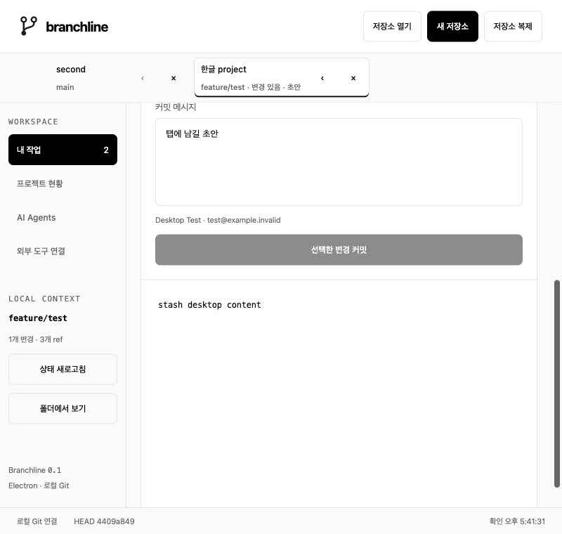

2. **이력·날짜·브랜치 입력 — 오류 복구 보완.** 역전된 기간을 오류로 표시하고 초기화 후 이력을 다시 읽는다. 브랜치 폼의 IME 조합 제출 차단과 Escape를 검사했다. 물리 IME/스크린리더의 전체 동작은 별도 확인이 필요하다.

   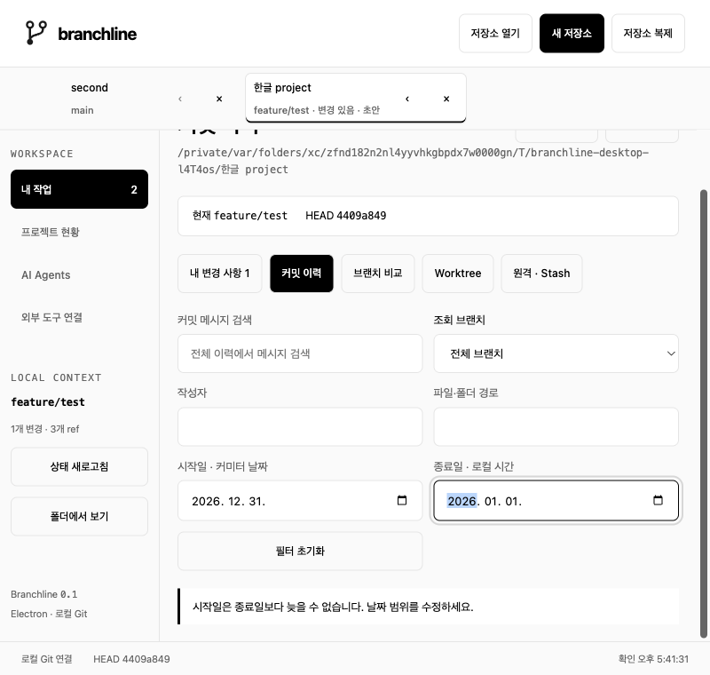

3. **비교·Worktree — 기존 흐름 유지, 내비게이션 보완.** 실제 Git 비교의 커밋 집합·재시작 복원과 worktree 목록을 확인했다. 전체 그래프·detached 생성·prune 같은 미구현 기능을 완료로 평가하지 않는다.

   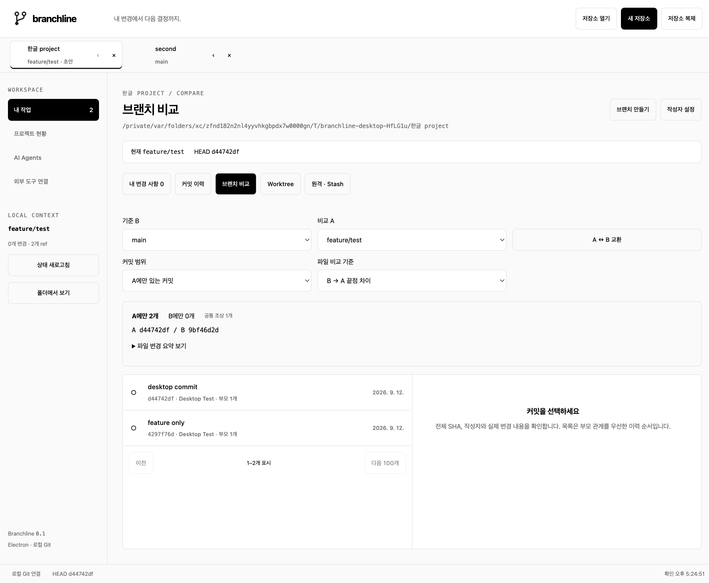
   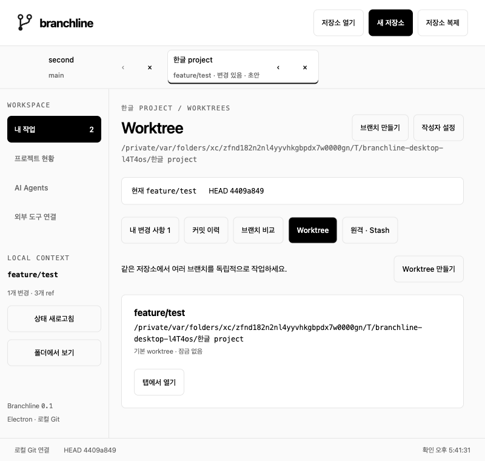

4. **원격·Stash — 실행 흐름 정상, 조회 실패 복구 보완.** 임시 bare remote를 사용한 Push/Fetch/upstream/clone/stash 검증과 별도의 조회 실패 fixture를 사용했다. 오류 이후 로딩을 종료하고 재시도한다.

   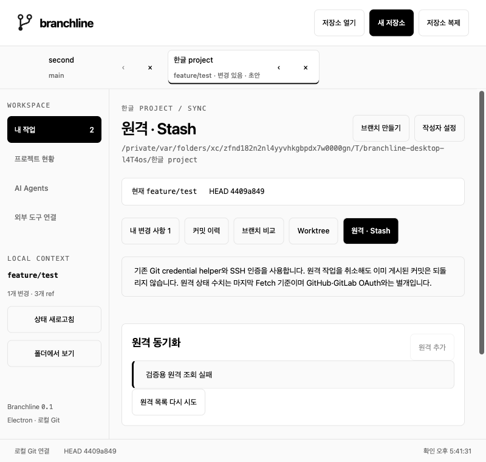

5. **PM의 PR/MR·CI 검토 — 정보 구조와 맥락 복원 개선.** 수정 전에는 계정·리뷰·CI·로컬 목록이 길게 이어졌다. 수정 후에는 리뷰/CI를 선택하고 목록에서 상세로 진입한다. 요약을 접고 파일·diff를 함께 본다. GitHub/GitLab 데이터는 통제된 HTTP 응답이며 실제 계정 승인/게시 검증을 대신하지 않는다.

   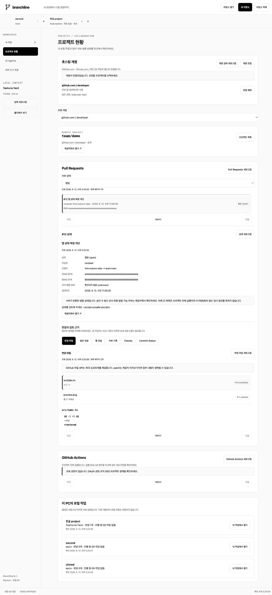
   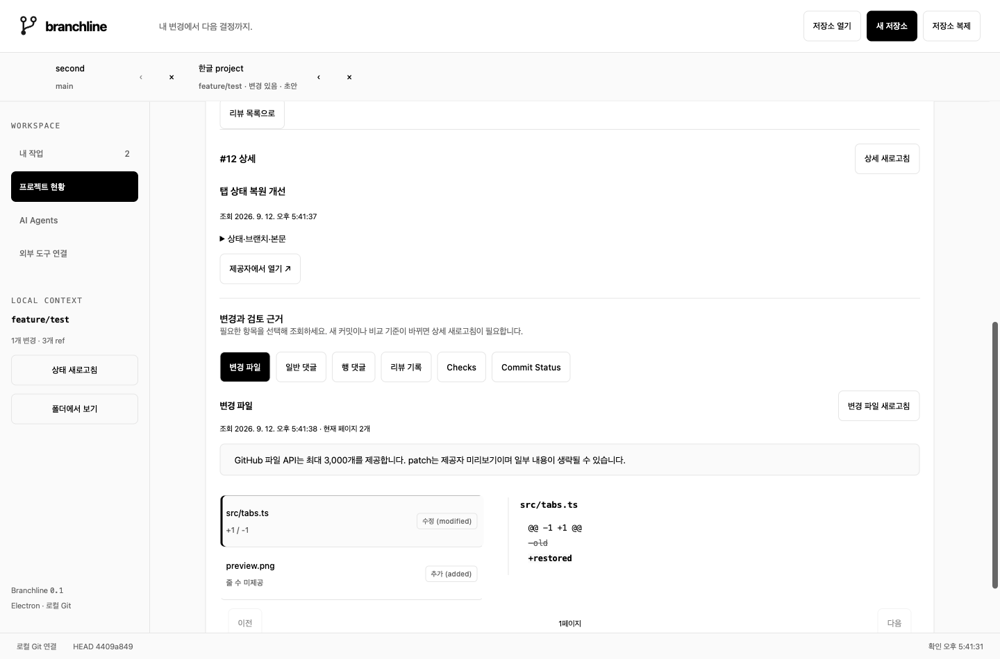
   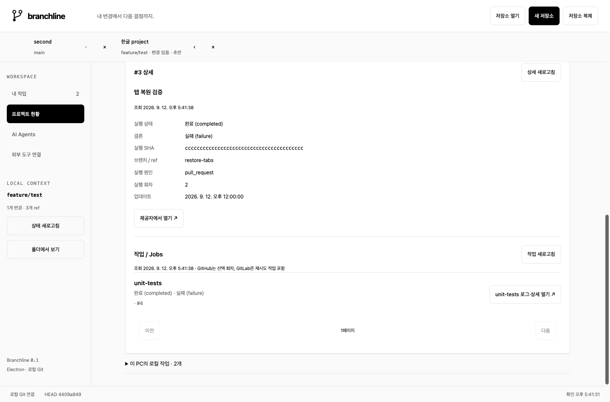

6. **Agent 설정·한도 — 이전 값 무효화와 테마 보완.** 재활성화 후 과거 수치를 지우고 무채색 막대를 사용한다. 아래 계정/버전/60%는 fixture이며 실제 계정의 사용량이 아니다. Claude/Gemini 자동 quota와 Agent 대화 실행은 여전히 미구현이다.

   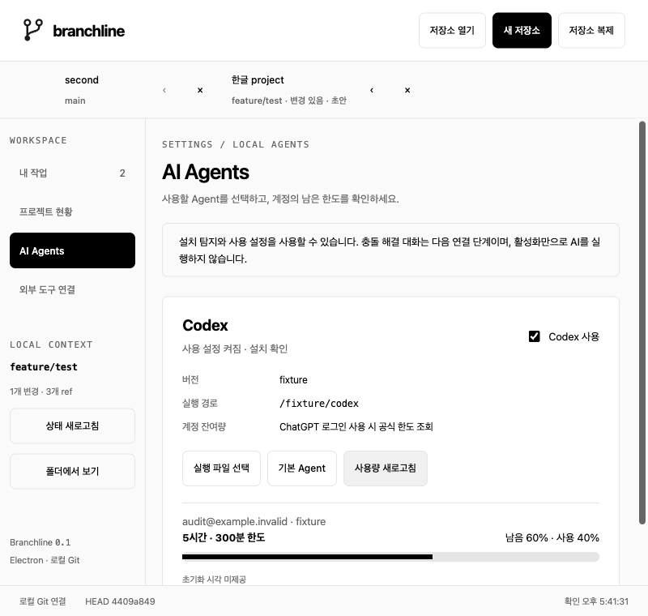

7. **외부 MCP 연결 — 새 설정의 저장소 범위 표시 수정.** 아래 수정 전 화면은 탭 2개인데 후보에 닫은 cloned가 남아 있다. 수정 후에는 열린 2개만 제공하며 생성한 Electron-as-Node 명령으로 실제 Git 읽기를 확인한다. 별도의 외부 클라이언트 설치 시험은 남아 있다.

   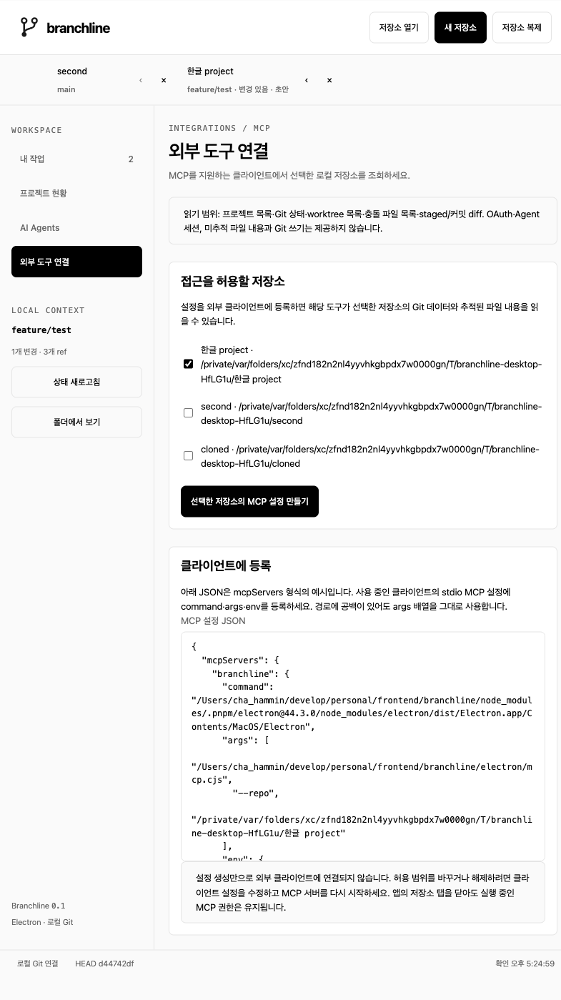
   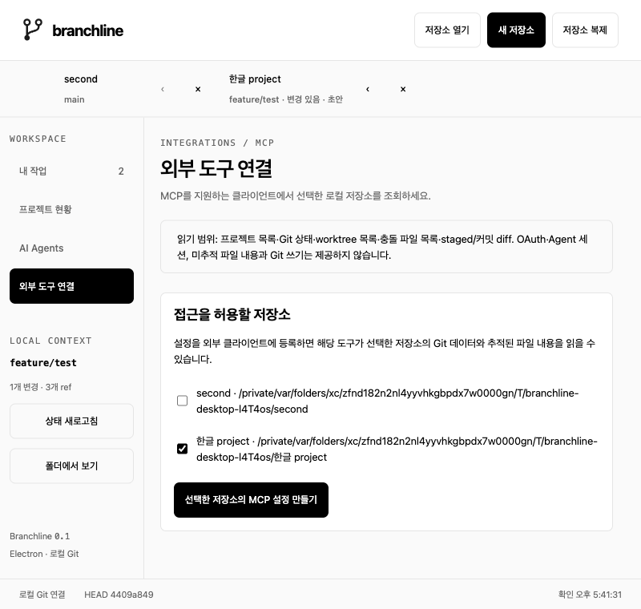

8. **최소 창·키보드 — 검사 범위에서 통과.** main을 Tab/PageDown으로 스크롤하고 760×580에서 가로 넘침·axe 위반을 확인한다. 독립적인 스크린리더/고배율/모든 OS 검증과 WCAG 인증 완료를 주장하지 않는다.

   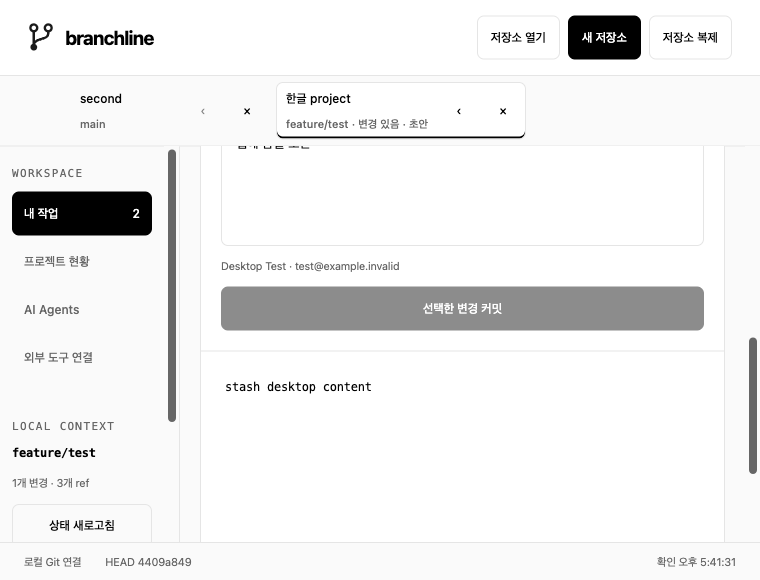

## 검증

- `pnpm check`: ESLint·TypeScript/Vite, Storybook 63개, Node 16개, native 키보드, Electron 기존 흐름·제품 품질 회귀, 정적 Storybook 빌드.
- `audit_project.py . --mode strict`와 DESIGN.md lint. 기존 Storybook 문서 번들의 500kB 초과 경고는 제품 런타임 실패와 구분한다.
- `pnpm package:desktop` 및 생성한 macOS arm64 앱에서 같은 Electron 시나리오. 서명·공증·공개 배포는 수행하지 않는다.
- 실행 가능한 회귀 검사: `scripts/check-product-quality.mjs`, `scripts/check-hosting.mjs`, 기존 Git/Agent/MCP 서비스 검사. 사용자 저장소·실제 로그인·유료 추론·외부 게시를 테스트 목적으로 사용하지 않는다.

## 출시 판단을 바꾸기 위해 남은 작업

우선순위 1은 실제 등록 앱 OAuth 승인·Keychain·실제 접근 권한 검증과 대화형 AI 충돌 처리의 실행/취소/파일 적용 경계다. 우선순위 2는 PM이 작업을 끝낼 수 있도록 PR/MR 생성·리뷰 제출·승인 정책·병합·CI 쓰기와 실패 복구를 완성하는 것이다. 우선순위 3은 개인 Git의 복구·hunk·고급 worktree, 큰 저장소 성능, 외부 MCP 클라이언트 및 OS별 검증, 서명·공증·업데이트다.

이 항목들은 이번 UI 결함 수정으로 해결된 것으로 표시하지 않는다. 세부 기능 상태는 [IMPLEMENTATION.md](../../IMPLEMENTATION.md)가 원본이다.
