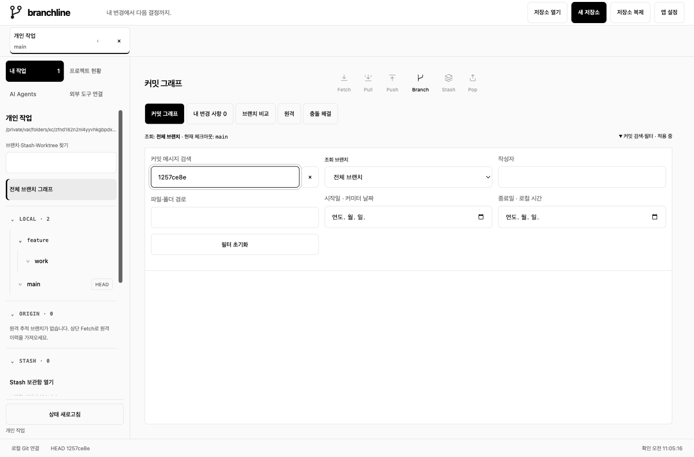
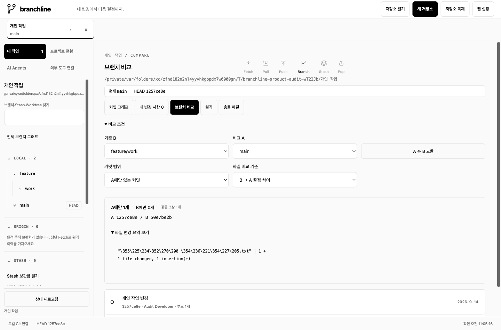
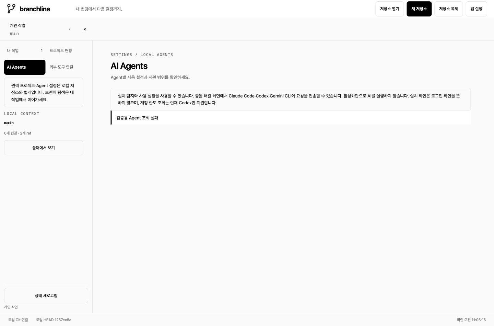

# Branchline 전체 기능·UI/UX 검증

> 후속 수정 상태: [제품 UX 감사 수정 결과](../product-ux-fixes-2026-09-14/RESULTS.md). 아래 본문은 수정 전 관찰 기록이다.

2026-09-14 · 현재 소스 빌드 · macOS Electron · 개인 개발자/PM 동등 기준

기본 Git 작업과 최근 개선한 그래프·Stash 연결은 동작한다. 다만 숙련 개발자가 비교→병합→충돌 중단까지 앱 안에서 끝내는 흐름과, PM이 병합을 막는 이유를 판단하는 흐름은 미완성이다. 자동 테스트 통과를 사용성 검증 완료로 해석하면 안 된다. 이번 추가 관찰에서 검색 결과 가림, 한글 경로 가독성, Agent 오류 복구, 프로필 오류·삭제·초안 처리 문제를 재현했다.

이번 요청은 검증과 수정 목록 작성이다. 제품 소스는 수정하지 않았으며 아래 항목의 수정 상태는 모두 **미수정/제안**이다. 추가한 것은 재현 스크립트와 보고서다. P0(데이터 손실·권한 침해)는 이번 검증 범위에서 새로 확인되지 않았다. P1은 핵심 작업의 단절 또는 출시 전 필수 조건, P2는 탐색·판단·복구·접근성 마찰로 분류한다. 미구현 기능과 현재 구현의 결함을 구별한다.

## 1. 실행 범위와 결과

- `BRANCHLINE_SCREENSHOTS=docs/product-ux-audit-2026-09-14 pnpm check`: 통과. Storybook 31개 파일/98개 테스트, Node 26개 테스트, native/Electron/초안 복구, renderer 및 Storybook build. [전체 로그](./check.log)
- `node scripts/audit-product-flows.mjs`: 추가 탐색 시나리오 완료. SHA 검색, 결과 가림, 비교, Worktree 생성, GitLab 연결, 프로필 검증/삭제/초안, MCP, Agent 실패를 관찰했다. [관찰 값](./flow-probes.json), [실행 로그](./flow-probes.log)
- Premium strict 정적 감사: 오류·경고 0개. [JSON](./premium-audit.json). 정적 감사가 아래 시각적 결함과 누락 기능을 탐지하지 못한다는 점도 확인했다.
- 추가 감사 스크립트 포함 `pnpm lint`: 통과.
- 1440×950, 800×760 및 최소 760×580 흐름, 키보드/IME/자동 접근성 검사, 실제 임시 Git 저장소, 임시 Electron 프로필로 검증했다.
- GitHub/GitLab OAuth·PR/MR·CI는 통제된 제공자 응답, Agent 대화는 임시 CLI 실행 파일, 사용량은 통제된 응답이다. 실제 사용자 계정 승인·원격 게시·유료 AI 요청은 하지 않았다.

## 2. 단계별 플로우

아래 화면은 모두 이번 감사 실행에서 캡처하고 직접 열어 확인했다. `정상`은 해당 검증 시나리오 통과를 뜻하며 그 영역의 모든 예외나 향후 기능 완료를 뜻하지 않는다.

| 단계 | 사용자 작업 | 확인 상태 | 남은 마찰·참고 화면 |
| --- | --- | --- | --- |
| 1 | 처음 실행 → 저장소 열기/생성/복제 | 정상 | 계정 없이 로컬 작업 진입. [시작](./01-start.png) |
| 2 | 여러 저장소 탭 → 전환/닫기/재시작 | 정상 | 초안 보존·탭과 checkout 분리. 다수 탭 검색/고정/드래그는 후속 기능. [탭과 로컬 작업](./quality-changes.png) |
| 3 | 그래프 → 브랜치 탐색/필터/커밋 상세 | 일부 개선 필요 | 무한 스크롤·연속 부모 연결·컬럼 조절·선택 해제는 정상. 검색 피드백 가림과 SHA 이동 부재. [그래프](./02-history.png), [검색](./03-sha-search.png) |
| 4 | 내 변경 → 스테이징 → 커밋 | 기본 정상 | 파일 단위 작업·검토·초안 보존. hunk/전체 스테이징/폐기 복구 부재. [변경](./quality-changes.png) |
| 5 | 브랜치 비교 → 다음 Git 작업 | 미완성 | 집합 비교 정상. 한글 경로 표시 문제·파일별 diff·병합/Rebase 진입 부재. [비교](./04-compare.png) |
| 6 | Fetch/Pull/Push → upstream/원격 관리 | 기본 정상 | 로컬 bare 원격에서 검증. Pull은 fast-forward, 분기된 이력의 후속 처리·원격 수정/삭제는 미지원. [검증 로그](./check.log) |
| 7 | Stash 선택 → 그래프 위치 → 변경 → 복원/삭제 | 정상, 동선 개선 가능 | 오래된 항목/미추적 파일/번호 변경/충돌 시 보존 검증. 상세에서 복원하려면 보관함으로 재이동. [Stash](./stash-graph.png) |
| 8 | Worktree 목록 → 새 작업 공간/탭 | 부분 구현 | 새 브랜치 생성·열기·잠금·삭제 정상. 기존 브랜치/detached 생성 부재. [생성](./05-worktree-create.png) |
| 9 | 외부 충돌 감지 → AI/수동 수정 → 저장/해결/계속 | 기본 정상, 복구 미완성 | 초안·버전 검사 정상. Git 작업 중단 부재, 긴 페이지 때문에 대화·양쪽 입력·결과를 함께 보기 어려움. [충돌](./desktop-conflicts.png), [좁은 창](./agent-chat-narrow.png) |
| 10 | Agent 설정 → 선택/사용량/실패 | 일부 개선 필요 | 토글·기본 Agent·Codex 수치 표시는 통제된 테스트 통과. 최초 조회 실패 복구 동작 부재. [오류](./10-agent-error.png), [사용량](./quality-agent-usage.png) |
| 11 | GitHub/GitLab 연결 → 프로젝트 선택 | 출시 조건 남음 | 코드 승인/취소/권한 실패/계정 격리 검증. 현재 GitLab 연결에는 직접 등록한 공개 앱 ID 필요, 자체 호스팅 주소 입력 부재. [연결](./06-gitlab-onboarding.png) |
| 12 | PM 모아보기 → PR/MR 상세/검토/병합 | 부분 구현 | 조회·파일·댓글·검토 후 쓰기·버전 재검사 통과. 필수 검사/승인 최종 집계와 다중 원격 프로젝트 맥락 유지 부족. [모아보기](./project-watchlist.png), [검토](./desktop-review-files.png), [쓰기 확인](./remote-write-preview.png) |
| 13 | CI 실행 → Jobs → 재실행/취소 | 기본 정상 | 실행 회차·SHA·부분 오류 처리 통과. 새 실행·앱 내 로그 부재. [CI](./desktop-hosting.png) |
| 14 | 작성자 프로필 → 저장/적용/삭제 | 수정 필요 | 저장/적용은 정상. 필드별 오류·초안 초기화 보호·삭제 확인/복구 부족. [입력 오류](./07-profile-validation.png), [삭제](./08-profile-deleted.png) |
| 15 | MCP 범위 선택 → 외부 클라이언트 설정 | 부분 구현 | 생성된 설정의 프로토콜 시험 통과. JSON 수동 등록 후 실제 연결 확인 경로 부재. [설정](./09-mcp-setup.png) |

## 3. P1 — 핵심 흐름과 출시 조건

| 순서 / ID | 유형·문제 | 사용자 영향 | 수정 방향·완료 기준 | 근거 |
| --- | --- | --- | --- | --- |
| 1 / F01 | 미구현: 비교 뒤 Merge/Rebase 시작 불가 | 서로 갈라진 브랜치를 앱에서 비교한 뒤 외부 CLI로 나가야 한다. fast-forward Pull 실패의 후속 동선도 끊긴다. | 현재 checkout과 병합할 브랜치, 적용 방향을 명시하고 검토→실행→충돌 해결을 연결. 양방향 비교와 dirty 상태에서 대상 혼동이 없어야 한다. | 단계 5·6, `RepositoryWorkspace.tsx`, `electron/git.cjs`의 mutation 목록 |
| 2 / F02 | 미구현: 진행 중 Git 작업 중단 | 충돌 해결을 포기하고 원래 작업으로 돌아가려 해도 앱에 merge/rebase/cherry-pick 중단 경로가 없다. | 작업 종류에 맞는 중단, 저장 전 편집/작업 파일 영향 확인, 중단 후 상태 재조회. AI 요청 취소와 Git 작업 중단을 별개 동작으로 표시. | 단계 9, `ConflictWorkspace.tsx`, `RepositoryWorkspace.tsx`, native mutation 목록 |
| 3 / F03 | 출시 조건: 일반 사용자 OAuth 연결이 등록 앱 ID에 의존 | PM이 계정 연결 전에 GitLab Applications를 만들고 권한을 해석해야 한다. | 배포용 공개 OAuth 앱 구성과 실제 승인/갱신/해제 검증. 사용자 지정 앱은 고급 설정으로 두고 등록 안내·필수값·오류별 해결 동선을 제공. | 단계 11, 현재 연결 화면, `AccountConnections.tsx` |
| 4 / F04 | 제품 공백: 병합을 막는 이유의 최종 요약 부족 | Checks, Status, 리뷰/승인 기록을 따로 읽어야 하며 제공자에서 최종 조건을 다시 확인해야 한다. PM이 앱에서 다음 담당자·다음 행동을 결정하기 어렵다. | 현재 Head 기준 필수 검사/승인/충돌/보호 규칙의 확인 가능한 상태·근거·미확인 항목을 한곳에 집계. 오래된 APPROVED 기록을 현재 승인으로 계산하지 않는다. 서버 보호 규칙을 우회하지 않는다. | 단계 12, `ReviewDetail`, `ReviewResources`, `ProjectWatchlist` |
| 5 / F05 | 미구현: 기존 브랜치 Worktree 생성 | 이미 있는 작업/리뷰 브랜치를 별도 작업 공간으로 열 수 없고 새 브랜치 이름을 요구한다. | ‘기존 브랜치 / 새 브랜치 / 커밋에서 분리’를 구분. 다른 worktree에서 사용 중인 브랜치와 경로 충돌을 설명하며 허용되는 경우만 생성. | 단계 8, 생성 화면과 `worktree-add` 경로 |

## 4. P2 — 재현된 결함

| ID | 재현·관찰 | 왜 불편한가 | 수정 방향·완료 기준 |
| --- | --- | --- | --- |
| D01 | 검색 필터를 열고 결과가 없는 문자열 입력. ‘일치하는 커밋이 없습니다’가 필터 패널 뒤에 가려짐. `elementFromPoint`가 안내문 대신 브랜치 select를 반환했다. | 사용자에게 빈 화면처럼 보이며 검색 완료/실패/결과 없음 구분이 안 된다. | 결과 상태를 필터와 겹치지 않는 위치에 표시. 입력 중·검색 완료·0개 상태가 패널을 닫지 않아도 보이고 키보드로 접근 가능해야 한다. |
| D02 | 한글 경로가 포함된 브랜치 비교의 파일 요약에 `\355\225...` 형태가 출력됨. Stash 상세의 동일 종류 경로는 정상 표시. | 어떤 파일이 바뀌었는지 바로 식별할 수 없으며 화면 간 표시가 일관되지 않다. | 표시용 Git diff/show/stat 경로를 일괄 점검하고 한글 경로 표시 규칙을 공유. NUL 기반 실제 파일 처리와 표시 변환을 혼동하지 않아야 한다. |
| D03 | Agent 목록 최초 조회를 통제된 오류로 응답하면 오류만 남고 본문 버튼이 0개. | 다른 화면으로 나갔다 돌아와야 재시도할 수 있다. 오류가 다음 행동을 제공하지 않는다. | 공통 Notice+Button으로 ‘다시 조회’와 실행 파일 설정 진입 제공. 실패→재시도→성공을 같은 화면에서 완료. |
| D04 | 빈 작성자 프로필 저장 시 공통 오류 한 줄만 표시. `aria-invalid=true` 필드는 0개. | 문제 필드와 수정 위치가 연결되지 않아 특히 키보드/보조기기 사용자가 다시 찾아야 한다. | 공통 TextField의 error/hint를 사용해 필드별 오류와 설명 연결, 첫 오류로 포커스 이동. 값은 유지. |
| D05 | 저장한 프로필의 삭제를 누르면 확인 없이 즉시 사라짐. 새 프로필 입력 중 ‘새 프로필’을 다시 누르면 입력이 빈 문자열로 초기화됨. | 실수 클릭의 복구 경로와 저장 전 편집 보호가 없다. 기존 Git 작성자 설정 자체는 유지된다. | 삭제 확인 또는 실행 취소 제공. 프로필 전환/새 프로필 동작에서 변경 여부를 확인해 초안을 보존하거나 명시적으로 버리게 한다. |

D01~D05는 [재현 스크립트](../../scripts/audit-product-flows.mjs)와 [관찰 JSON](./flow-probes.json)에 기록했다. D02의 Stash/비교 차이는 [비교 화면](./04-compare.png)과 [Stash 화면](./stash-graph.png)에서 확인할 수 있다. D05를 저장소/커밋 손실로 확대 해석하지 않는다.

## 5. P2 — 작업 효율·정보 구조 보완

| ID | 영역·현재 한계 | 제안 |
| --- | --- | --- |
| U01 | 커밋 검색은 메시지 전용. 존재하는 HEAD 짧은 SHA를 입력해도 결과가 없다. | 메시지 검색과 별도로 SHA/ref 빠른 이동 또는 통합 검색을 제공. 애매한 짧은 SHA는 선택지로 해결. 지원하지 않는 입력을 단순 ‘없음’으로 오해하지 않게 한다. |
| U02 | 개인 변경 검토는 파일 단위 stage/unstage. 한 파일에 여러 목적의 변경을 섞어 작업하기 어렵다. | 파일 트리·hunk 선택·전체 stage/unstage, 폐기 전 변경 검토와 복구 경로. hunk와 복구는 기능 구현·검증을 별도 작업으로 취급. |
| U03 | 로컬 브랜치 생성/조회/전환 뒤 관리 기능이 얇다. | 브랜치 이름 변경/삭제, 커밋의 cherry-pick/revert, reflog 기반 복구 진입. 메뉴만 추가하지 말고 예상 결과·보호 조건·실패 복구까지 연결. |
| U04 | 비교는 A/B 집합과 파일 통계 중심이고 제목/설정 영역이 크다. 100개 페이지 탐색은 그래프의 연속 탐색과 다르다. | ‘기준 → 비교 대상’ 방향을 명확히 쓰고 파일별 전체 diff/split view 제공. 비교 조건은 접을 수 있게 유지하고 현재 방향·범위는 요약으로 고정. 각 목록의 탐색 전략을 명시. |
| U05 | 작은 창에서 그래프·제목·Stash 상세가 모두 좁아짐. 상세 요약만으로 세로 공간 대부분을 사용한다. | 공통 InspectorPanel 너비 조절/확대 모드와 간결한 메타 헤더. 파일 요약→파일 선택→diff로 이동하게 하되 그래프와 선택 맥락은 유지. 현재 창 범위를 벗어나는 전체 문서 overflow는 검증에서 없었다. |
| U06 | Stash 읽기는 그래프, 복원/삭제는 별도 보관함. index/untracked 내부 커밋도 일반 기록처럼 보인다. | 선택 Stash 상세에서 해당 SHA의 복원/Pop/관리 진입을 연결하고 의미를 명시. 내부 커밋은 설명·구분부터 제공하며 부모 관계를 부정확하게 그리지 않는다. |
| U07 | 충돌 화면에 안내·파일 선택·AI 대화·양쪽 입력·편집 결과가 긴 페이지로 쌓임. | 파일 목록, 현재 작업/적용 변경, 결과 편집을 작업 영역 중심으로 배치. AI 대화는 보조 패널, 기술 설명은 필요할 때 펼치기. 좁은 창에서도 저장/검토/해결 상태가 가까워야 한다. |
| U08 | PM 모아보기는 최대 5개 프로젝트의 각 첫 30개를 수동 조회. 목록이 프로젝트별로 길게 쌓임. | ‘내 검토 요청 / 실패 CI / 승인 대기’ 필터와 담당·대기 기간·다음 행동 중심 표시. 부분 조회 한계를 유지 표기하고 원격 프로젝트별 선택/탭 맥락 보존. |
| U09 | GitLab.com/GitHub.com만 연결. 자체 호스팅 GitLab/Enterprise 주소를 설정할 수 없다. | 기업 저장소가 타깃일 때 별도 호스트 연결을 우선순위에 추가. 인증/API 허용 범위·인증서·저장소 매핑을 함께 설계. 현재 계정 연결 버그로 분류하지 않는다. |
| U10 | AI 설정은 설치/활성/기본 선택과 Codex 한도 중심. 로그인 계정의 준비 상태, Claude/Gemini 한도는 충분히 확인할 수 없다. | 설치·인증 확인 가능 여부·사용 설정·실행 중 상태를 분리. 미지원 수치는 그대로 미지원 표시하며 추정 잔여량을 만들지 않는다. 실제 세션 검증을 출시 조건으로 둔다. |
| U11 | CI는 기존 실행/Jobs 조회·재실행·취소. 실패 원인 확인은 외부 로그, 새 workflow/pipeline 실행은 없음. | 특정 실행 회차의 실패 Job→로그→재시도 동선을 줄이고 신규 실행 시 브랜치/입력값/부작용 검토 제공. |
| U12 | MCP는 설정 JSON 생성 이후 수동 등록. 복사/내보내기·클라이언트별 안내·연결 진단이 없다. | JSON 복사/내보내기, 클라이언트 선택 안내, 연결 확인과 허용 범위 변경 절차 제공. 생성 성공을 연결 성공으로 표시하지 않는다. |
| U13 | 저장소 탭이 많으면 가로 스크롤 의존. 그래프는 불러온 행을 계속 DOM에 유지. | 탭 목록 검색·고정·키보드 이동, 큰 이력의 가상 렌더링 성능 측정. 현재 307개 및 오래된 Stash 탐색 성공을 수만 커밋 성능 보장으로 해석하지 않는다. |

## 6. 권장 수정 순서

1. **사용을 막는 핵심 흐름**: F01·F02. 비교→Git 작업→충돌 해결→완료/중단을 한 흐름으로 완성한다. F03은 실제 등록 앱 준비와 승인 검증이 필요하므로 함께 시작한다.
2. **재현된 UI 결함**: D01~D05. 기존 공통 컴포넌트와 표시 함수 수정으로 해결할 수 있는 항목을 먼저 닫고 이번 재현을 회귀 검사로 바꾼다.
3. **PM 판단·Worktree 완결성**: F04·F05. 개인 작업과 관리자의 리뷰 판단을 동등하게 완성한다.
4. **매일 반복하는 조작 단축**: U01~U07. SHA 이동·파일/hunk 검토·Stash 동작·충돌 편집 밀도를 개선한다.
5. **연결·규모 확장**: U08~U13. PM 필터/원격 맥락, 자체 호스팅, Agent 준비 상태, CI 로그, MCP 설정, 많은 탭·대규모 이력 검증.

색상·폰트 전체 교체보다 현재 흑백 디자인 시스템에서 정보 밀도, 오류 위치, 다음 행동, 화면별 상태 보존을 먼저 수정하는 편이 효과적이다. Drag/폭 조절에는 기존 ResizeHandle의 키보드 대안을 유지하고 버튼/폼/Notice/Dialog는 기존 디자인 컴포넌트로 구현한다.

## 7. 시각 근거

### 검색 피드백 가림

필터를 연 상태에서는 결과 없음 안내가 실제로 패널 뒤에 가려진다.

같은 검색 상태에서 필터만 닫으면 안내가 드러난다.

### 한글 경로·Agent 오류

## 8. 검증 한계

실제 OAuth 등록 앱 승인/갱신, macOS Keychain 저장, GitHub/GitLab 운영 보호 규칙, 실제 AI 계정별 추론/사용량, 외부 MCP 클라이언트, Windows/Linux 설치와 동작, 서명·공증·자동 업데이트는 이번 검증에서 완료하지 않았다. 수만 커밋·대량 브랜치 성능, 스크린리더의 실제 발화, 200% 확대 전체 화면 조합도 미검증이다. 자동 axe 검사가 통과했다고 WCAG 전체 준수를 주장하지 않는다. 화면에서 읽을 수 있는 경로인지, 실패 후 사용자가 돌아올 수 있는지 등은 별도 관찰 결과다.
