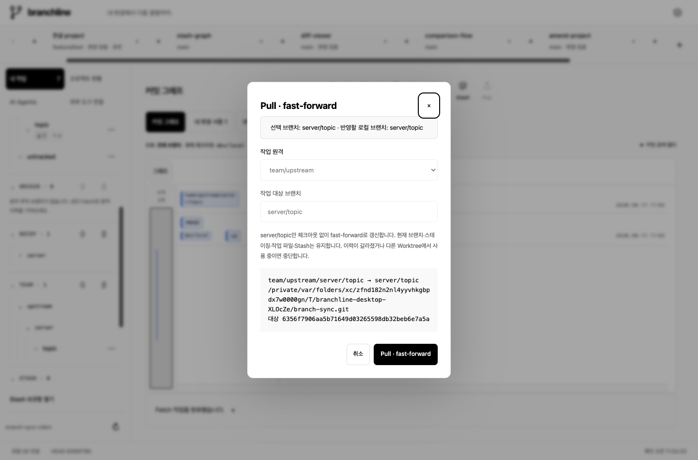
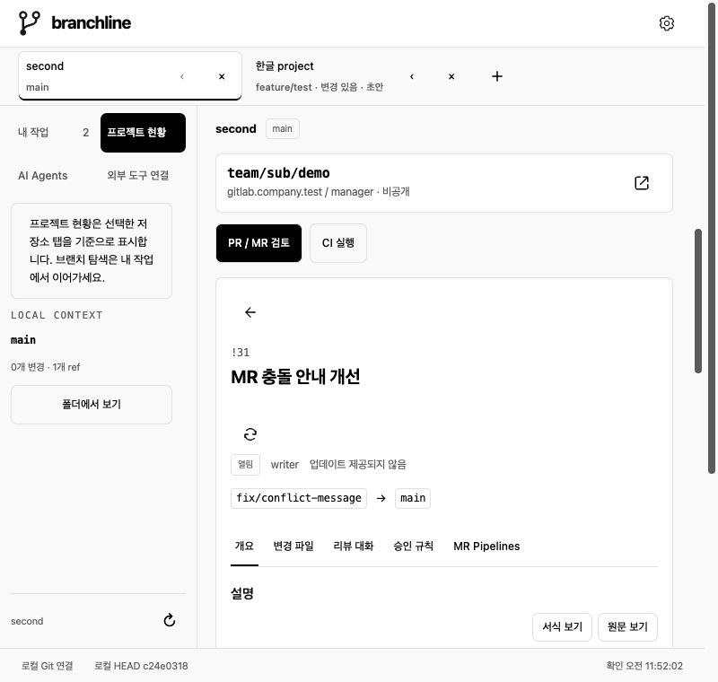
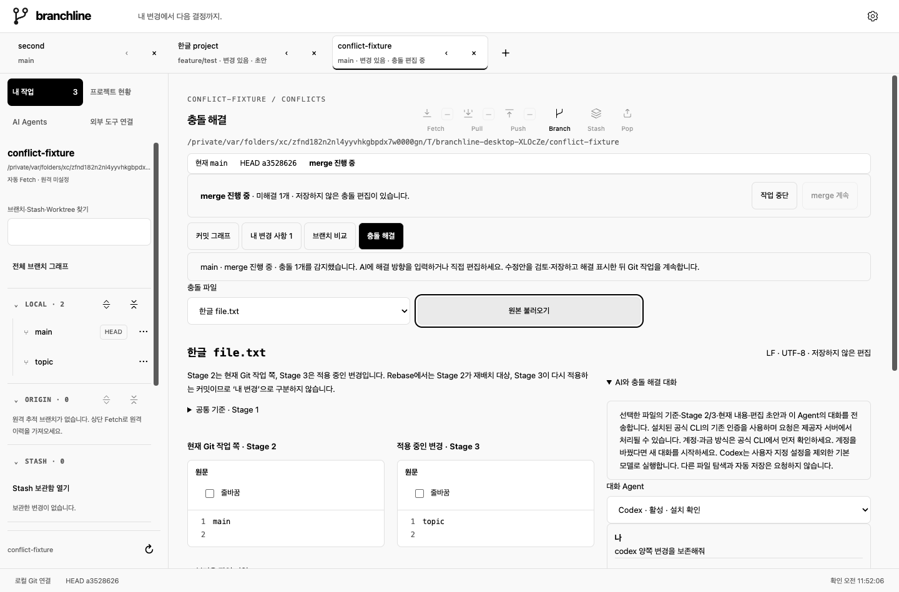

# 체크아웃 없는 Pull 및 제품 흐름 검증

검증일: 2026-09-17. macOS에서 현재 소스의 Electron 앱을 실행했다. 개발자의 로컬 Git 작업과 PM의 PR/MR·CI 검토를 함께 점검했다. 아래 이미지는 이번 검증에서 새로 캡처한 화면이다.

## 이번 수정

LOCAL 브랜치의 우클릭 → **Fetch / Pull → Pull…**에서 선택한 로컬 브랜치를 체크아웃 없이 갱신한다. 추적 중인 원격 브랜치와 실제 반영할 로컬 브랜치를 미리 보여준다. 원격 메뉴의 **현재 브랜치로 Pull…**은 현재 브랜치에 반영하는 기존 의미를 유지한다.

- 비활성 로컬 브랜치: Git의 강제 옵션 없는 refspec으로 fast-forward 갱신. 현재 HEAD·index·작업 파일·미추적 파일·기존 Stash·FETCH_HEAD를 유지한다.
- 현재 브랜치: 기존 자동 Stash → Pull → apply → 성공한 자동 Stash만 삭제하는 흐름을 유지한다.
- 다른 Worktree에서 사용 중인 대상, 분기된 이력, 없는 브랜치, 오래된 검토 상태는 차단한다. 강제 갱신이나 자동 Merge/Rebase는 하지 않는다.
- 원격이 로컬보다 뒤로 돌아갔거나 로컬에만 커밋이 있는 경우도 비 fast-forward 갱신으로 거부될 수 있다. Fetch 후 브랜치 비교에서 확인한다.
- Git의 `--atomic`으로 원격 추적 ref와 대상 로컬 ref를 함께 갱신한다. 근거: [Git fetch 공식 문서](https://git-scm.com/docs/git-fetch).

## 평가

검증한 범위에서는 새 P0(데이터 손실·권한 침해)나 P1(잘못된 결과·핵심 작업 실패)을 재현하지 않았다. 기능의 안전장치와 오류 복구는 통제된 테스트를 통과했다. 다만 **작업 공간을 차지하는 헤더·안내의 높이, 일부 탐색 명칭, PM의 전체 프로젝트 집계**에는 개선할 여지가 있다. 테스트 통과를 전체 무결함이나 운영 환경 인증으로 보지 않는다.

### 우선순위별 개선 목록

| 순서 | 우선순위·상태 | 관찰·재현 | 영향 | 권장 수정·완료 기준 |
| --- | --- | --- | --- | --- |
| 1 | P2 · 이번 수정 완료 | 다른 LOCAL 브랜치의 Pull이 체크아웃을 요구했다. | 여러 브랜치를 관리할 때 작업 전환과 임시 보관이 불필요하게 발생했다. | 선택한 로컬 ref만 갱신. 실제 Git과 Electron에서 현재 파일·Stash 보존, 다른 Worktree·분기 차단을 확인했다. |
| 2 | P2 · 후속 | [좁은 MR 상세](mr-overview-narrow.png)에서 뒤로 가기·제목·새로고침이 각각 큰 세로 영역을 쓰고, 설명은 화면 아래쪽에서 시작한다. | PM이 제목을 확인한 뒤 본문·검사·병합 가능 여부까지 반복해서 스크롤한다. | 공통 상세 헤더의 제목/뒤로/새로고침을 함께 정렬하고 상태·브랜치 정보를 압축한다. 800px 창에서 본문 첫 구간이 바로 보이는지 확인한다. |
| 3 | P2 · 후속 | [충돌 화면](desktop-conflicts.png)에 작업 상태, 충돌 안내, Stage 설명, AI 전송 설명이 연속 배치된다. 1440×950에서도 편집·저장 흐름이 첫 화면 아래로 이어진다. | 충돌을 해결하려는 개발자가 코드와 다음 행동을 찾기 어렵다. | 진행 상태는 한 줄로 통합하고 상세 설명은 Disclosure로 이동한다. 원본 양쪽·결과 편집·저장/해결 표시를 중심에 배치하되 AI 전송 정보는 첫 실행 전에 확인 가능하게 유지한다. |
| 4 | P2 · 후속, 코드 확인 | 원격 이름 `team/upstream`을 지원하지만 Sidebar는 첫 `/`에서 잘라 `TEAM`으로 그룹화한다. 원격이 없는 저장소에도 [ORIGIN 0](repository-graph.png) 그룹이 생긴다. `RepositorySidebar.tsx`의 remotes 구성에서 확인했다. | 실제 원격 이름과 폴더 이름이 혼동되고, 사용하지 않는 그룹이 탐색 공간을 차지한다. 동기화 대상 해석은 별도 로직으로 정상 검증됐다. | syncState의 실제 원격 목록과 가장 긴 이름 접두어를 사용해 그룹화한다. `team`과 `team/upstream`이 함께 있을 때 중복 없이 정확히 표시하는 회귀 검증을 추가한다. |
| 5 | P2 · 기능 한계, 후속 | [CI 실패 필터](ci-failure-filter.png)는 현재 페이지의 최대 30개 PR/MR을 검사한다. 안내와 현재 페이지 건수는 표시하지만 프로젝트 전체 실패 건수는 아니다. | PM이 전체 실패 목록을 모으려면 다음 페이지를 계속 확인해야 한다. | 우선 필터 이름/건수 근처에 `현재 페이지`를 더 직접 표시한다. 전체 집계는 취소·진행률·API 제한·미확인 상태를 포함한 별도 조회로 구성한다. 현재 페이지 건수를 전체 건수로 표시하면 안 된다. |
| 6 | P2 · 후속 | [최소 창](quality-minimum-window.png)에서 220px 사이드바와 상단 탭을 유지한 채 작업 목록/커밋/차이를 세로 배치한다. 기능에는 접근할 수 있지만 비교 공간이 작다. | 작은 화면에서 목록과 코드를 왕복하는 비용이 크다. | 접을 수 있는 공통 사이드바를 검토한다. 기존 크게 보기는 유지하고 닫기/Esc/포커스 복귀를 동일하게 적용한다. |

2~6번은 이번에 수정 완료했다고 보고하지 않는다. 우선 요청한 Pull 기능을 구현하고 전체 검증에서 발견한 후속 작업을 분리했다.

## 실제 흐름별 검증

| 단계 | 흐름 | 확인 결과·근거 |
| --- | --- | --- |
| 1 | 저장소 열기·탭·초안 | 열기/복제/탭 전환, 닫기 취소, 초안 복원, 탭 넘침과 + 메뉴의 키보드 접근 통과. [탭 화면](repository-tabs-overflow.png) |
| 2 | 그래프·브랜치 탐색 | 307개 커밋의 누적 조회, 페이지 경계의 lane·스크롤 유지, 미니맵 이동, 컬럼 크기 조절, Solo와 위치 이동 분리, tooltip 검증. [그래프](repository-graph.png) |
| 3 | Fetch·Pull·Push | 임시 bare 원격에서 실제 Git 실행. 비활성 브랜치 Pull, 다른 이름의 upstream, `/` 포함 원격, 현재 브랜치 자동 Stash, 실패·충돌 복구, 좁은 메뉴와 키보드 검증. [메뉴](branch-sync-menu.png), [자동 Stash](pull-autostash-preview.png) |
| 4 | 내 변경 사항·커밋·Amend | 새 파일의 초록 diff, 추가/삭제 수, index와 작업 파일 구분, 부분 스테이징, 파일 메뉴, 메시지와 staged Amend의 검토·오래된 상태 차단 통과. [변경 사항](working-changes.png), [Amend](amend-review.png) |
| 5 | 커밋·Stash 상세·diff | 오래된 Stash 위치 자동 조회, 순서 변경 후 SHA 유지, 파일 트리, 통합/좌우/원본, 확대/닫기/Esc, 포커스 및 보기 상태 유지 검증. [Stash](stash-graph.png), [확대 diff](review-diff-expanded.png) |
| 6 | 비교·Cherry-pick·Merge/Rebase | 양쪽 그래프·공통 조상·방향 교환, 검토한 SHA 적용, 취소, 충돌 발생/중단을 임시 저장소에서 검증. [비교](comparison-dual.png) |
| 7 | Worktree·파일 편집 | 기존/새 브랜치 Worktree, 작업 폴더 탭, 실제 저장, CRLF, 외부 수정 감지, binary 차단, 미저장 닫기 보호 통과. [Worktree](quality-worktrees.png), [편집](working-file-editor.png) |
| 8 | 충돌 해결·AI | 외부 Merge 감지, 자동 화면 진입, 초안 보존, Stage 1/2/3 읽기, 검토 후 저장, 복구와 명시적 continue 검증. Claude/Codex/Gemini는 통제된 CLI로 대화·취소·오류·IME·수정안 검토를 확인했다. [충돌](desktop-conflicts.png) |
| 9 | PR/MR·CI | 현재 탭 원격 프로젝트 연결, 검색/담당/리뷰/기간/CI 실패 필터, 페이지 이동, 상세·Markdown·변경 파일·승인 규칙, 원격 쓰기 미리보기, Head 기준 CI와 부분 오류를 모의 API로 검증. [CI 필터](ci-failure-filter.png), [CI 작업](desktop-hosting.png) |
| 10 | 계정·Agent·MCP | 회사 GitLab PAT 입력 흐름, OAuth 취소/재시작/계정 분리, Agent 활성화와 사용량 새로고침, 선택 저장소만 MCP 접근하는 경계를 통제된 데이터로 검증. [PAT](gitlab-pat.png), [Agent](quality-agent-usage.png), [MCP](desktop-mcp.png) |
| 11 | 공통 UX·접근성 | 760×580 최소 창, 네이티브 Dialog/Esc/포커스 복귀, 한글 IME, 오류 후 재시도, axe 검사 통과. [최소 창](quality-minimum-window.png) |

## 실행한 검증

- `pnpm check` 성공: lint, renderer 빌드, Storybook/Vitest **171개**, native UI 검사, Git/호스팅/보안 **54개**, Electron 전체 회귀, 초안 복구 회귀, Storybook 빌드.
- `node --test electron/sync.test.cjs` 최종 재실행: **12개 통과**. FETCH_HEAD 보존 검사 포함.
- premium strict 정적 검사: 오류 0, 경고 0. [결과](static-audit.json)
- `designmd lint DESIGN.md`: 오류 0, 경고 0.
- `git diff --check` 성공.
- 정상 종료 후 `env -u ELECTRON_RUN_AS_NODE pnpm desktop`으로 최신 빌드 재시작. 기존 두 저장소 탭·선택 브랜치·그래프가 복원됐다. 실제 앱에서 비활성 LOCAL 브랜치의 Pull이 활성화되고 `체크아웃 없이 갱신` 확인 화면과 정확한 원격→로컬 방향이 표시되는 것을 확인한 뒤 취소했다.
- 번들 크기 500kB 초과 경고는 남아 있다. 동작 실패가 아니며 실제 시작 시간/메모리 측정 없이 성능 결함으로 단정하지 않았다.

## 검증 범위의 한계

실제 사용자 저장소에서는 화면을 읽고 메뉴를 확인하며, 테스트용 Pull/Commit/Push는 실행하지 않는다. 데이터 변경 검증은 임시 저장소에서만 진행했다. 회사 GitLab의 실제 권한/인증서/VPN, 실제 GitHub 원격 쓰기, 유료 AI 요청·실계정 사용량, Windows 설치/실행은 이번 결과에 포함하지 않는다. 앱의 기본 자동 Fetch는 기존 설정을 유지한다. 커밋·Push·Release 게시를 수행하지 않았다.
