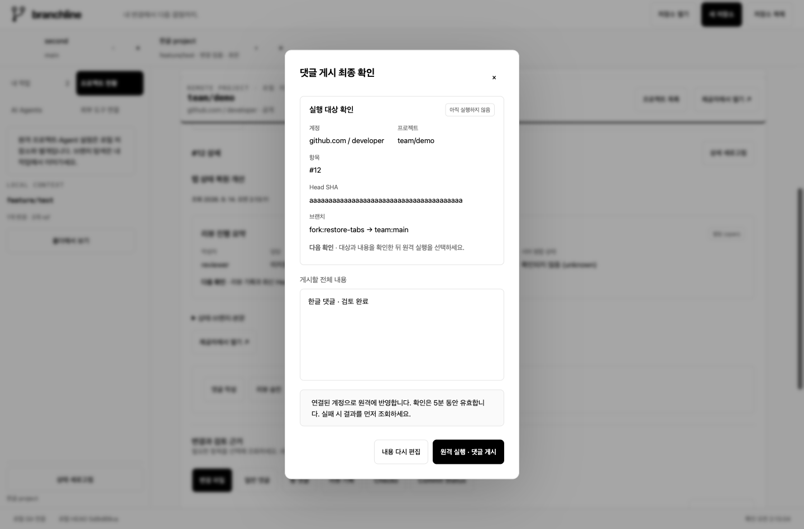
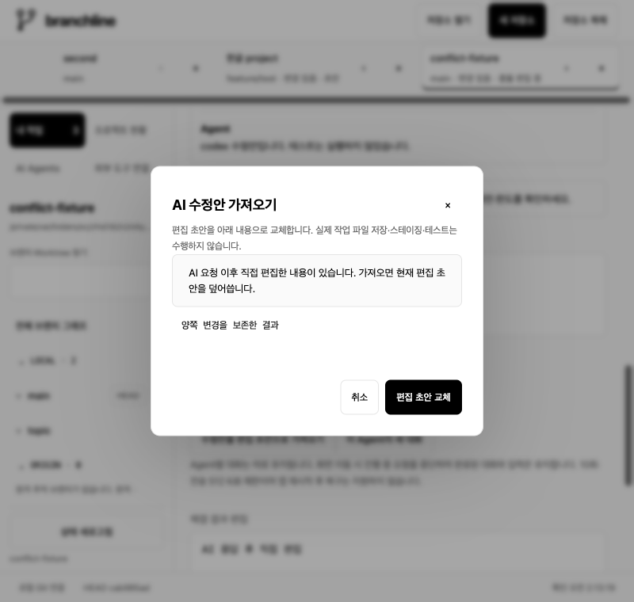
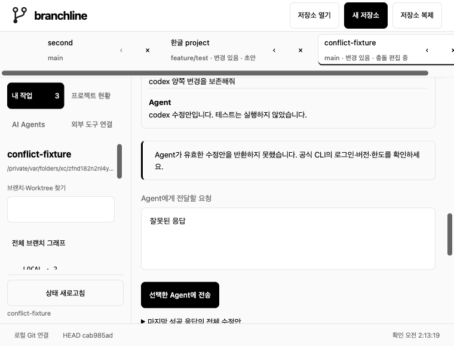

# 후속 기능 구현 및 검증 · 2026-09-14

기존 개인 Git·PM 현황 흐름 위에 AI 충돌 대화와 원격 쓰기를 연결했다. 실제 계정·유료 서비스 검증이나 공개 릴리스 완료를 의미하지 않는다.

| 우선순위 | 기존 문제 | 수정 | 근거 |
| --- | --- | --- | --- |
| P1 | Agent를 켜도 충돌 해결 요청을 보낼 수 없음 | Claude Code·Codex·Gemini CLI 실행, 입력·후속 질문·중단, Agent별 대화, JSON 수정안 검토 | `electron/agents.test.cjs`, `scripts/check-agent-chat.mjs` |
| P1 | AI 결과로 직접 편집한 초안이 덮어써질 위험 | 마지막 성공 수정안의 전체 내용과 초안 변경 경고, 명시적 가져오기·별도 저장, 원본 token 재검사 | 실제 임시 충돌 Git 저장소의 파일 불변·검토·저장 시험 |
| P1 | PR/MR·CI가 읽기만 지원 | 같은 프로젝트 PR/MR 생성, 일반 댓글·승인·병합, GitHub 변경 요청, Actions 재실행·GitLab 실패/취소 작업 재시도·CI 취소 | `electron/hosting.test.cjs`, 실제 preload/main을 통과하는 `scripts/check-hosting.mjs` |
| P1 | 확인 후 원격 상태 변화·응답 유실 시 잘못된 쓰기/중복 게시 가능 | main의 5분 단회 작업안, 실행 전 SHA/상태/회차 검증, 승인·병합 SHA 전달, 자동 재전송 금지 | 변경된 Head·CI 회차·만료·중복 사용·결과 불명 시험 |
| P2 | 조회 연결이 쓰기를 허용했는지 불명확 | OAuth 연결에서 원격 쓰기 별도 선택, 계정별 허용 표시, 최종 확인에 대상·본문·효과 표시 | 연결 폼·최종 확인·권한 거절 시험 |
| P2 | 대화/오류/초안 UI 일관성 부족 | 공통 Conversation 신규 생성·공개·Storybook 4개 상태, 기존 ActionSummary·Dialog·폼 재사용 | Storybook·axe·한글 IME·760×580 창 시험 |

## 확인한 동작

- `pnpm check`: lint, TypeScript/Vite, Storybook **78개 / 26개 파일**, native 검사, Node **25개**, Electron E2E, 초안 복구 회귀, 정적 Storybook 빌드 통과.
- 마지막 CLI 옵션·원격 승인 검증 보완 후 관련 Node 검사 및 lint를 추가 통과했다. Gemini는 임시 폴더의 도구 제한 설정, Claude는 built-in 도구 비활성·MCP 차단, Codex는 read-only 및 사용자 설정 제외 옵션을 fixture에서 확인했다.
- 세 Agent의 UI → preload → main → **통제된 가짜 실행 파일** → 응답 검증 → 편집 초안 교체를 통과했다. 잘못된 JSON, 빠른 중단, Agent 전환, 상위 화면 이동 후 입력 보존, IME Enter, 요청 후 직접 편집 경고를 확인했다. 원본 파일은 사용자가 별도로 저장할 때까지 바뀌지 않았다.
- GitHub/GitLab 원격 API는 **통제된 HTTP 응답**만 사용했다. GitHub 빈 201/202 응답을 정상 접수로 처리하고, GitLab 승인 시 최신 diff의 Head와 patch 식별자를 확인한다. 실제 토큰 발급·댓글 게시·병합·CI 실행은 하지 않았다.
- tested 화면의 axe WCAG 2 A/AA·2.1 AA 오류 0. 원격 확인창·AI 수정안·최소 창 크기의 스크린샷을 직접 확인했다. premium strict 오류/경고 0, DESIGN lint 오류/경고 0.
- 서명 없는 macOS arm64 번들 생성 후 전체 Electron 기능 검사와 초안 보호·자동 갱신·정상 종료 검사를 모두 통과했다. 결과는 `packaged.log`, `packaged-recovery.log`에 기록했다.

실행 로그: [전체 검사](./check.log), [Agent 검사](./agents.log), [패키징](./package.log), [설치본 기능 검사](./packaged.log), [설치본 종료/초안 검사](./packaged-recovery.log), [디자인 정적 검사](./premium-audit.json).

## 남은 조건과 다음 우선순위

1. **실제 CLI·계정 검증**: 현재 인증·과금 방식은 각 공식 CLI가 소유한다. Branchline의 계정 선택/인증 변경 감지, CLI 버전·관리형 정책별 실제 추론·도구 제한 검증은 남아 있다. 계정을 바꿨으면 새 대화를 시작해야 한다. 토큰/인증 파일을 앱이 복사하지 않는다. Claude Code 제품 내 실행은 제공자 조건을 충족해야 한다. [Claude 조건](https://code.claude.com/docs/en/legal-and-compliance)
2. **배포 OAuth**: `electron/oauth-clients.json`의 GitHub/GitLab 공개 ID는 아직 비어 있다. 등록 앱의 공개 ID와 실제 Device 승인·Keychain 보관·갱신/철회 검증이 필요하다. Client Secret은 받지 않는다.
3. **AI 경험 확장**: 실시간 텍스트 스트리밍, 실행 중 추가 지시, 계정별 대화 분리 자동화, 재시작 복구, Claude/Gemini 공식 잔여 한도, 실행별 토큰/비용 표시. 현재는 최종 응답·중단 후 재요청, 10회·512 KiB 제한이며 임시 폴더는 OS 전체 접근 격리를 뜻하지 않는다.
4. **협업 확장**: 신규 workflow_dispatch/Pipeline 생성, fork 간 PR/MR 생성, 인라인 리뷰, GitLab 변경 요청, 필수 검사·승인 최종 집계와 merge queue. 현재 생성·댓글·CI API는 조회 직후 외부 변경을 원자적으로 잠글 수 없으며 최종 결과를 다시 조회한다. [GitHub PR](https://docs.github.com/en/rest/pulls/pulls), [Actions](https://docs.github.com/en/rest/actions/workflow-runs), [GitLab MR](https://docs.gitlab.com/api/merge_requests/), [Pipelines](https://docs.gitlab.com/api/pipelines/)
5. **릴리스**: macOS 서명·공증·업데이트, Windows/Linux 설치·실행, 실제 외부 MCP 클라이언트별 검증. 공개 release를 게시하지 않았다.

현재 전체 기능 표는 [IMPLEMENTATION.md](../../IMPLEMENTATION.md)가 원본이다. 기존 감사/수정 보고서는 당시 증거로 유지한다.
