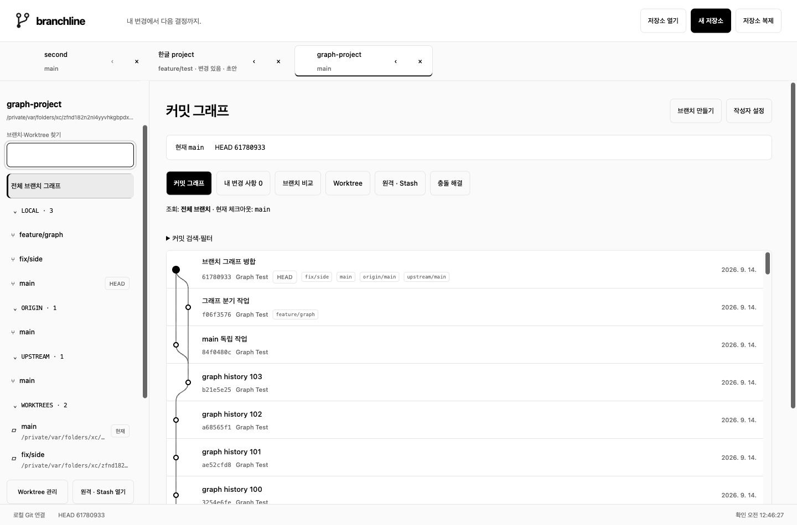
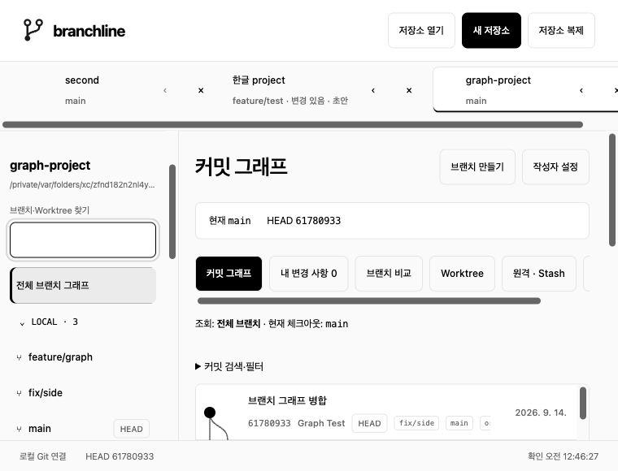

# 그래프 첫 화면과 저장소 사이드바

2026-09-14 · 로컬 알파 0.1.0

저장소를 열면 커밋 그래프부터 볼 수 있고, 활성 저장소의 LOCAL·ORIGIN·추가 원격·WORKTREES를 왼쪽에서 탐색하도록 변경했다. 이전의 시작 화면은 변경 파일 목록이었고, 실제 그래프 대신 일렬 커밋 목록을 표시했다.

## 변경한 동작

- 저장소 새로 열기·다시 열기·앱 재시작은 그래프로 시작한다. 열린 탭 간 이동에서는 이전 보기를 유지하며 기존 커밋 초안을 지우지 않는다.
- 실제 Git 부모 SHA로 분기/병합 선을 그린다. HEAD와 ref 이름을 표시하며 커밋을 선택하면 실제 diff 상세가 열린다. 선택 전에는 그래프를 넓게 표시한다.
- LOCAL·ORIGIN·추가 원격 이름별 브랜치와 연결된 worktree를 한 사이드바에서 제공한다. 전체 경로를 표시하고 검색·지우기·현재 위치·잠금/경로 오류 상태를 지원한다.
- 브랜치 클릭은 조회만 바꾸고 페이지·필터·상세 선택을 초기화한다. Checkout은 별도 확인을 거친다. Worktree 클릭은 해당 작업 디렉터리를 별도 탭으로 연다.
- BranchTree를 확장하고 공통 CommitGraph를 추가했다. Button·Disclosure·TextField·Badge·CodeDiff를 재사용했으며 새 의존성은 없다.
- 고급 커밋 필터는 접어서 첫 화면의 그래프 공간을 확보했다. 최소 창에서는 저장소 보기와 그래프 자체가 가로 스크롤을 소유하며 앱 전체가 가로로 넘치지 않는다.

## 검증 근거

실제 임시 Git 저장소에 107개 커밋, 두 부모를 가진 병합, LOCAL/ORIGIN/UPSTREAM refs, 별도 worktree를 만들어 검증했다. 이력 조회로 checkout이 바뀌지 않음, 100개 다음 페이지에서 브랜치 변경 시 첫 페이지 복귀, 검색 초기화·포커스, 키보드 worktree 탭 이동, 상세 열기/닫기를 검사한다. 전체 회귀 검사는 기존 staging/commit·탭 초안·원격/stash·호스팅·충돌 해결 흐름도 포함한다.

그래프 Storybook은 병합·필터로 누락된 부모·octopus 병합·별도 루트·키보드·빈 상태를 검증한다. 실제 화면 검토에서 발견한 접근성 설명의 앱 바깥 세로 넘침을 수정하고, 최소 창과 넓은 창의 프레임 높이/너비 검사를 추가했다.

검증 결과: `pnpm check` 통과(Storybook 70개, Node 21개, native·Electron E2E·Storybook build). 최신 소스의 서명 없는 macOS arm64 번들에서도 전체 Electron E2E를 통과했다. 최소 창 760×580, axe WCAG 2 A/AA·2.1 AA, 프레임 가로/세로 넘침 검사를 포함한다. premium strict audit 오류/경고 0, DESIGN lint 오류/경고 0.

[전체 검사](./check.log) · [패키징](./package.log) · [번들 실행](./packaged-verification.log)

## 현재 경계

원격 브랜치는 마지막 로컬 조회/Fetch 기준이다. 자동 네트워크 조회·prune을 실행하지 않는다. 이력은 100개 페이지이며 페이지/필터 밖의 부모를 점선으로 표시한다. 페이지 간 레인 좌표 연속성·그래프 편집·drag rebase는 제공하지 않는다. 서명 없는 macOS arm64 번들을 검증하며 공개 릴리스·Windows/Linux 실행을 완료한 것으로 보고하지 않는다.
